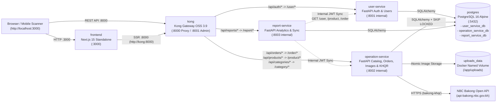

# Coffee Shop Microservices & Kong APIM Platform

A full-stack coffee shop ordering and point-of-sale (POS) platform built with a **Next.js 15** web frontend, **Kong Gateway 3.9** as the unified API Management (APIM) entry point, three independent **FastAPI** microservices (`user-service`, `operation-service`, `report-service`), **PostgreSQL 16**, and real **National Bank of Cambodia (NBC) Bakong KHQR** payments (`bakong-khqr`). Guests can browse the shop and product catalog, customize drinks, and add items to a cart without logging in; login is required only when placing an order at checkout, and customers can share a product link with a rich preview card so friends can view and order.

> **Study Project Notice**: This repository is a university study project designed to run locally on **Windows with Docker Desktop (WSL2 Linux containers)** — **NOT a production deployment**. Every recommendation below is labeled **[MUST]**, **[SHOULD]**, or **[NICE-TO-HAVE]**.

---

## 1. Features

- **Guest Storefront, Persistent Cart & Login-to-Order Flow**:
  - Guests (not logged in) can open the shop (`/`), browse the product catalog and categories (`/products`), and view product details (`/products/[id]`) without logging in.
  - Guests can select drink customizations (e.g., size, sugar level, milk options) and add items to a safe browser `localStorage` cart (`useCartStore` with `try/catch` storage guards and zero secrets stored).
  - Login is required only when placing an order (`/checkout` or `/orders`). Guests pressing **Checkout** or **Log in to order** are redirected to `/login?next=/checkout` (validated by `sanitizeNextPath` against open-redirect vectors) and returned to checkout after login or sign-up with their cart intact.
  - Authenticated customers create orders (`POST /api/orders`) with atomic stock reservation and can cancel pending orders (`POST /api/orders/{id}/cancel`).
- **Real NBC Bakong KHQR Checkout**:
  - Generate dynamic EMVCo-compliant KHQR codes (`USD` or `KHR`) locally via `bakong-khqr==0.6.5` with CRC16-CCITT and MD5 digest tracking.
  - Render crisp SVG QR codes (`qrcode.react`) with a live 15-minute UTC countdown timer and Bakong mobile deeplink support, plus middle-ellipsis truncation (`TruncatedValue`) and one-click copy for 64-character Bakong transaction references.
  - Automatic background payment verification (`SELECT ... FOR UPDATE SKIP LOCKED` worker with adaptive backoff and 60-second late-payment reconciliation) plus on-demand status check (`POST /api/orders/{id}/payment/verify`).
- **Product Image Upload & Media Serving**:
  - Staff and admin users can upload, preview, replace, edit alt text, and delete product images (`JPEG`, `PNG`, `WebP`, up to `5 MB` and `4000x4000` px) on the centered Create Product and Edit Product pages.
  - Backend validates file content by magic bytes (never trusting client filenames or `Content-Type`), prevents decompression bombs (`Image.MAX_IMAGE_PIXELS`), re-encodes images with Pillow (`pillow==12.1.1`) to strip EXIF/GPS metadata, and stores files atomically on a dedicated Docker volume (`uploads_data`) while persisting metadata in PostgreSQL (`product_images`).
  - Product images are displayed across the product catalog, product detail page, shopping cart, checkout page, and order details, and served publicly through Kong (`/api/media/{storage_key}`) with `X-Content-Type-Options: nosniff` and immutable caching.
- **Share a Product Link with a Rich Preview Card**:
  - Single **Share** button (`ShareLink`) on product detail pages that invokes the native Web Share sheet (`navigator.share` with URL passed only in `url`) when available, or copies the clean canonical product link (`/products/{id}`) to the clipboard with `"Link copied"` confirmation.
  - Server-rendered Open Graph (`og:title`, `og:description` with formatted price, `og:url`, `og:type`, `og:site_name`, `og:locale`, `og:image`, `og:image:width`, `og:image:height`, `og:image:alt`), Twitter card (`summary_large_image`), and `<link rel="canonical">` tags on `/products/[id]` backed by a dynamic `1200x630` Open Graph card image route (`/products/[id]/opengraph-image`) with fallbacks to the product's primary uploaded photo and default `/images/product-og.png`.
- **Staff & Admin Operations**:
  - Role-based access control (`customer`, `staff`, `admin`) enforced with stateless HS256 JWT tokens.
  - Manage categories, products, customizations, manual stock restocking/adjustments (`stock_movements` audit log), order status transitions (`pending` -> `paid` -> `completed` / `cancelled`), and manual refund recording.
- **Sales & Inventory Reports**:
  - Dedicated `report-service` with local snapshot synchronization (`POST /api/reports/sync`), sales summary, daily revenue breakdown, top-selling products, low-stock alerts, and user role analytics.
- **Unified API Gateway (Kong OSS 3.9)**:
  - Single entry point on `http://localhost:8000` handling path routing (`strip_path`), CORS preflight termination, per-IP rate limiting (`policy: local`, 100 req/min global, 10 req/min on `/api/auth/login`), 10 MB request size limits, and `X-Request-ID` correlation tracing.

---

## 2. System Architecture



### Services & Port Mapping

| Compose Service | Container Name (`docker-compose.yml` / `local`) | Responsibility | Internal Port | Published Host Port (Loopback Only) |
| :--- | :--- | :--- | :--- | :--- |
| **`frontend`** | `coffee_frontend` / `coffee_local_frontend` | Next.js 15 App Router UI, SSR Open Graph tags, KHQR checkout dialog | `3000` | `127.0.0.1:3000` |
| **`kong`** | `coffee_kong_gateway` / `coffee_local_kong` | API Gateway proxy (`:8000`) and local-only Admin API (`:8001`) | `8000`, `8001` | `127.0.0.1:8000` (Proxy)<br>`127.0.0.1:8001` (Admin API) |
| **`user-service`** | `coffee_user_service` / `coffee_local_user_service` | Registration, login, bcrypt password hashing, JWT issuance, user RBAC | `8001` | *None* (internal Docker network only) |
| **`operation-service`** | `coffee_operation_service` / `coffee_local_operation_service` | Categories, products, product image uploads (`uploads_data:/app/uploads`), stock movements, orders, Bakong KHQR & verification worker | `8002` | *None* (internal Docker network only) |
| **`report-service`** | `coffee_report_service` / `coffee_local_report_service` | Snapshot sync from `user-service` & `operation-service`, sales/stock/user reports | `8003` | *None* (internal Docker network only) |
| **`postgres`** | `coffee_postgres` / `coffee_local_postgres` | PostgreSQL 16 hosting `user_service_db`, `operation_service_db`, `report_service_db` | `5432` | *None* in `docker-compose.yml`<br>`127.0.0.1:5433` (or `POSTGRES_HOST_PORT`) in `docker-compose.local.yml` |

---

## 3. Tech Stack & Verified Versions

All versions below are taken directly from [`requirements.txt`](requirements.txt), [`requirements-dev.txt`](requirements-dev.txt), [`docker-compose.yml`](docker-compose.yml), and `coffee_shop_frontend/package.json`:

| Layer | Technology | Version | Source File |
| :--- | :--- | :--- | :--- |
| **API Gateway (APIM)** | Kong Gateway OSS (DB-less declarative mode) | `3.9` (`_format_version: "3.0"`) | `docker-compose.yml`, `kong/kong.yml` |
| **Database** | PostgreSQL (Alpine Linux container) | `16-alpine` | `docker-compose.yml` |
| **Backend Runtime** | Python (Debian Bookworm Slim container) | `3.12-slim` | `*/Dockerfile` |
| **Backend Web Framework** | FastAPI + Starlette + Uvicorn | `0.137.1` / `1.3.1` / `0.49.0` | `requirements.txt` |
| **ORM & Migrations** | SQLAlchemy + Alembic + psycopg2-binary | `2.0.51` / `1.18.4` / `2.9.12` | `requirements.txt` |
| **Validation & Settings** | Pydantic + pydantic-settings | `2.13.4` / `2.16.1` | `requirements.txt` |
| **Auth & Security** | PyJWT (HS256) + bcrypt | `2.10.1` / `4.2.1` | `requirements.txt` |
| **Bakong KHQR SDK** | `bakong-khqr` + HTTPX | `0.6.5` / `0.28.1` | `requirements.txt` |
| **Image Processing & Uploads** | Pillow + `python-multipart` | `12.1.1` / `0.0.22` | `requirements.txt` |
| **Backend Testing & Lint** | Pytest + Respx + Polyfactory + Ruff + Mypy | `8.4.2` / `0.22.0` / `2.22.3` / `0.14.2` / `1.18.2` | `requirements-dev.txt` |
| **Frontend Runtime** | Node.js (Alpine Linux container) | `22-alpine` | `coffee_shop_frontend/Dockerfile` |
| **Frontend Framework** | Next.js (App Router, `output: 'standalone'`) + React | `^15.5.22` / `^19.0.0` | `coffee_shop_frontend/package.json` |
| **Frontend State & Data** | TanStack React Query + Zustand + Axios | `^5.62.11` / `^5.0.2` / `^1.7.9` | `coffee_shop_frontend/package.json` |
| **Forms, QR & Styling** | React Hook Form + Zod + `qrcode.react` + Tailwind CSS | `^7.54.2` / `^3.24.1` / `4.2.0` / `^4.0.0` | `coffee_shop_frontend/package.json` |
| **Frontend Testing & Lint** | Vitest + Testing Library + TypeScript + ESLint | `^4.1.12` / `^16.3.3` / `^5.7.2` / `^9.17.0` | `coffee_shop_frontend/package.json` |

---

## 4. Folder Structure

```text
D:\Study\Year-4\Python\
├── coffee_shop/                        # Backend & Docker Compose Git repository root
│   ├── .github/workflows/              # CI pipeline configuration (ci.yml)
│   ├── docs/                           # Architecture, Docker, Kong APIM, Bakong KHQR, and Railway deploy guides
│   ├── infra/railway/                  # Railway deployment templates (Kong template, compose simulation)
│   ├── kong/                           # Kong Gateway declarative configuration (kong.yml)
│   ├── libs/testing/coffee_testing/    # Shared test fixtures and JWT/payload helpers
│   ├── operation_service/              # Catalog, stock, orders, and Bakong KHQR microservice (:8002)
│   │   ├── app/                        # FastAPI routes (api/), core/, models/, repository/, schemas/, services/
│   │   ├── migrations/                 # Alembic migration environment and schema versions
│   │   └── tests/                      # Operation & Bakong KHQR unit/integration tests
│   ├── postgres/                       # PostgreSQL entrypoint init script (init-databases.sh)
│   ├── report_service/                 # Analytics & snapshot sync microservice (:8003)
│   │   ├── app/                        # FastAPI routes, snapshot models, sync_service, report_service
│   │   └── tests/                      # Report and sync service tests
│   ├── scripts/                        # PowerShell & Bash helper scripts (up, down, ps, logs, migrate, smoke)
│   ├── tests/                          # Cross-service end-to-end integration test suite
│   ├── user_service/                   # Authentication & user management microservice (:8001)
│   │   ├── app/                        # FastAPI routes, JWT/bcrypt security, user models & services
│   │   └── tests/                      # User authentication and RBAC tests
│   ├── docker-compose.yml              # Primary Docker Compose stack (coffee-shop-stack)
│   └── docker-compose.local.yml        # Local Docker stack with host Postgres port (coffee-shop-local)
└── coffee_shop_frontend/               # Sibling Next.js 15 TypeScript frontend (built by compose)
    ├── public/images/                  # Static assets including Open Graph fallback image (product-og.png)
    └── src/                            # Next.js App Router pages (app/), components/, features/, services/, store/
```

---

## 5. Prerequisites

- **[MUST]** **Windows 10 (Build 19044+) or Windows 11 (64-bit)** with **WSL2** enabled.
- **[MUST]** **Docker Desktop for Windows** (with the **WSL 2 based engine** enabled and running) including **Docker Compose v2** (`docker compose`).
- **[MUST]** **Git** and **Windows PowerShell 5.1+** (or PowerShell 7).
- **[MUST]** An **NBC Bakong Merchant Account ID** (`BAKONG_ACCOUNT_ID`) and **Bakong Developer API Token** (`BAKONG_TOKEN`) configured in `operation_service/.env` (`operation-service` fails fast on startup if either is missing).
- **[NICE-TO-HAVE]** Python 3.12+ and Node.js 22+ on the host if you want to run `pytest` or `npm test` directly outside Docker.

---

## 6. Quick Start (Copy-Paste for Windows PowerShell)

For full step-by-step instructions, see [`docs/DOCKER_START_GUIDE.md`](./docs/DOCKER_START_GUIDE.md).

```powershell
# 1. Enter the project folder
cd D:\Study\Year-4\Python\coffee_shop

# 2. Copy environment templates (if not already created)
Copy-Item .env.example .env
Copy-Item user_service\.env.example user_service\.env
Copy-Item operation_service\.env.example operation_service\.env
Copy-Item report_service\.env.example report_service\.env

# 3. Edit operation_service\.env (and user_service\.env / report_service\.env)
#    Set identical JWT_SECRET_KEY across all 3 services, and set BAKONG_TOKEN + BAKONG_ACCOUNT_ID in operation_service\.env
notepad operation_service\.env

# 4. Build and start all 6 containers in the background
docker compose up -d --build

# 5. Check that all 6 containers reach (healthy) status
docker compose ps

# 6. Run Alembic database migrations for operation-service
docker compose exec operation-service alembic upgrade head

# 7. Verify gateway health and run the automated smoke test suite
curl.exe -s http://localhost:8000/health
powershell -ExecutionPolicy Bypass -File .\scripts\smoke.ps1
```

### Deploy on Railway

For deploying this platform to Railway cloud hosting using monorepo private networking, PostgreSQL, DB-less Kong Gateway, and Next.js same-origin reverse proxy, refer to the step-by-step guide:
👉 **[Railway Deploy Guide (`docs/RAILWAY_DEPLOY_GUIDE.md`)](./docs/RAILWAY_DEPLOY_GUIDE.md)**

---

## 7. Environment Variables Reference

> **[MUST] Secret Handling Rule**: Never commit `.env` files or real credentials to Git. Below are variable **NAMES** and safe placeholders only.

| Variable Name | Purpose | Example Placeholder | Used By Service(s) | Secret? |
| :--- | :--- | :--- | :--- | :--- |
| `ENVIRONMENT` | Runtime mode (`local`, `dev`, `staging`, `production`, `test`) | `local` | `user-service`, `operation-service`, `report-service` | No |
| `DB_HOST` | PostgreSQL hostname (`postgres` inside Docker, `localhost` on host) | `postgres` | `user-service`, `operation-service`, `report-service` | No |
| `DB_PORT` | PostgreSQL internal TCP port | `5432` | `user-service`, `operation-service`, `report-service` | No |
| `DB_NAME` | Service-specific database name | `operation_service_db` | `user-service`, `operation-service`, `report-service` | No |
| `DB_USER` | PostgreSQL database username | `postgres` | `postgres`, all 3 backend services | No |
| `DB_PASSWORD` | PostgreSQL database password | `<your-db-password>` | `postgres`, all 3 backend services | **Yes** |
| `DATABASE_URL` | Optional full SQLAlchemy PostgreSQL URL (overrides `DB_*` parts) | `postgresql+psycopg2://postgres:<password>@postgres:5432/operation_service_db` | All 3 backend services | **Yes** |
| `POSTGRES_HOST_PORT` | Host loopback port mapped to Postgres in `docker-compose.local.yml` | `5433` | `postgres` (`docker-compose.local.yml`) | No |
| `JWT_SECRET_KEY` | Shared HMAC-SHA256 signing key (**must be identical across all 3 services**) | `<32-char-minimum-random-secret>` | `user-service`, `operation-service`, `report-service` | **Yes** |
| `JWT_ALGORITHM` | JWT signing algorithm | `HS256` | `user-service`, `operation-service`, `report-service` | No |
| `JWT_ACCESS_TOKEN_EXPIRE_MINUTES` | Customer/staff access token lifetime in minutes | `60` | `user-service` | No |
| `SERVICE_TOKEN_EXPIRE_MINUTES` | Internal sync service-account JWT lifetime in minutes | `5` | `report-service` | No |
| `USER_SERVICE_BASE_URL` | Internal URL for `report-service` to pull user snapshots | `http://user-service:8001` | `report-service` | No |
| `OPERATION_SERVICE_BASE_URL` | Internal URL for `report-service` to pull product/order snapshots | `http://operation-service:8002` | `report-service` | No |
| `SYNC_PAGE_SIZE` | Page size used by `report-service` snapshot pagination | `100` | `report-service` | No |
| `SYNC_TIMEOUT_SECONDS` | Outbound HTTP timeout in seconds for report snapshot synchronization | `30.0` | `report-service` | No |
| `CORS_ORIGINS` | Comma-separated allowed CORS origins | `http://localhost:3000,http://127.0.0.1:3000` | All 3 backend services | No |
| `BAKONG_ACCOUNT_ID` | Merchant Bakong account ID receiving funds (fail-fast required) | `<your-merchant@bank>` | `operation-service` | **Yes** |
| `BAKONG_TOKEN` | NBC Bakong Developer API Bearer JWT token (fail-fast required) | `<your-bakong-jwt-token>` | `operation-service` | **Yes** |
| `BAKONG_API_BASE_URL` | NBC Bakong Open API base URL | `https://api-bakong.nbc.gov.kh` | `operation-service` | No |
| `BAKONG_REGISTERED_EMAIL` | Developer email used for `POST /v1/renew_token` | `<your-email@example.com>` | `operation-service` | **Yes** |
| `BAKONG_MERCHANT_NAME` | Merchant display name encoded in EMVCo Tag `59` | `Coffee Shop` | `operation-service` | No |
| `BAKONG_MERCHANT_CITY` | Merchant city encoded in EMVCo Tag `60` | `Phnom Penh` | `operation-service` | No |
| `BAKONG_STORE_LABEL` | Store label encoded in EMVCo Tag `62` Sub-tag `03` | `CoffeeShop-Main` | `operation-service` | No |
| `BAKONG_TERMINAL_LABEL` | POS terminal label encoded in EMVCo Tag `62` Sub-tag `07` | `POS-01` | `operation-service` | No |
| `BAKONG_PHONE_NUMBER` | Optional merchant phone encoded in EMVCo Tag `62` Sub-tag `02` | `<optional-phone-number>` | `operation-service` | No |
| `PAYMENT_EXPIRY_MINUTES` | Order payment expiration window enforced by backend worker | `15` | `operation-service` | No |
| `BAKONG_QR_EXPIRY_SECONDS` | EMVCo Tag `99` timestamp TTL in seconds (fallback generator) | `900` | `operation-service` | No |
| `BAKONG_MAX_AMOUNT_USD` | Maximum allowed real KHQR payment amount in USD (safety cap) | `1.00` | `operation-service` | No |
| `BAKONG_USD_TO_KHR_RATE` | Exchange rate used when converting USD order totals to integer KHR | `4100` | `operation-service` | No |
| `BAKONG_CALLBACK_URL` | Optional callback URL passed to Bakong deeplink generator | `http://localhost:3000` | `operation-service` | No |
| `UPLOAD_DIR` | Directory inside `operation-service` where uploaded product images are stored (mounted to `uploads_data` Docker volume) | `/app/uploads` | `operation-service` | No |
| `UPLOAD_MAX_BYTES` | Maximum allowed product image file size in bytes (default `5242880` = 5 MB) | `5242880` | `operation-service` | No |
| `UPLOAD_ALLOWED_TYPES` | Comma-separated allowed MIME types verified via magic bytes | `image/jpeg,image/png,image/webp` | `operation-service` | No |
| `UPLOAD_MAX_DIMENSION` | Maximum allowed image width or height in pixels | `4000` | `operation-service` | No |
| `UPLOAD_MAX_PIXELS` | Maximum allowed total pixel count (`Image.MAX_IMAGE_PIXELS` decompression-bomb guard) | `16000000` | `operation-service` | No |
| `PUBLIC_BASE_URL` | Public frontend base URL for Open Graph links and deeplink callbacks | `http://localhost:3000` | `operation-service`, `frontend` | No |
| `NEXT_PUBLIC_API_BASE_URL` | Browser-side API base URL pointing to Kong Gateway proxy | `http://localhost:8000` | `frontend` | No |
| `INTERNAL_API_BASE_URL` | Server-side (SSR) API base URL inside Docker network | `http://kong:8000` | `frontend` | No |

---

## 8. URLs and Ports

All host ports are bound strictly to `127.0.0.1` (loopback) so they are never exposed to the local LAN/Wi-Fi network:

| Endpoint | URL | Access Scope | Purpose |
| :--- | :--- | :--- | :--- |
| **Next.js Frontend** | `http://localhost:3000` | Host Browser | Customer storefront, cart, KHQR payment dialog, staff/admin dashboard |
| **Kong Gateway Proxy** | `http://localhost:8000` | Host Browser / API Clients | Single API entry point (`/api/auth`, `/api/products`, `/api/categories`, `/api/orders`, `/api/reports`, `/health`) |
| **Kong Admin API** | `http://127.0.0.1:8001` | **Localhost Only** | Read-only inspection of Kong services, routes, plugins, and status (`/status`, `/services`, `/routes`, `/plugins`) |
| **Gateway Health Check** | `http://localhost:8000/health` | Host / Docker Healthcheck | Proxies to `operation-service` `/health` (`{"status":"ok","database":"connected"}`) |
| **Service Health Checks** | `http://localhost:8000/health/user`<br>`http://localhost:8000/health/operation`<br>`http://localhost:8000/health/report` | Host / Smoke Tests | Individual microservice + PostgreSQL connectivity checks through Kong |

*(Note: Kong Manager GUI on port `8002` is not enabled in this stack; port `8002` inside the Docker bridge network is used internally by `operation-service`.)*

---

## 9. Common Commands (Windows PowerShell)

```powershell
# Start all services in the background
docker compose up -d

# Stop all services while keeping PostgreSQL data intact
docker compose down

# View container status and health checks
docker compose ps

# Follow real-time logs for all services (or a single service like operation-service)
docker compose logs -f
docker compose logs -f operation-service

# Rebuild a single service without cache and recreate its container
docker compose build --no-cache operation-service
docker compose up -d --force-recreate --no-deps operation-service

# Apply .env changes to a service (NOTE: 'docker compose restart' does NOT re-read .env!)
docker compose up -d --force-recreate operation-service
```

---

## 10. Security & Real Money Safety Notes

- **[MUST] Never Commit Secrets**: `.env`, `.env.*` (except `.env.example`), and `*.pem` are git-ignored. Never paste `BAKONG_TOKEN`, `BAKONG_ACCOUNT_ID`, `DB_PASSWORD`, or `JWT_SECRET_KEY` into documentation, commits, or frontend `NEXT_PUBLIC_*` variables.
- **[MUST] Real Money Warning**: `operation-service` uses `RealBakongClient` (`bakong-khqr`) connected to NBC Bakong. Scanning a generated KHQR code with a live Cambodian banking app transfers **real money** to the configured `BAKONG_ACCOUNT_ID`. Keep `BAKONG_MAX_AMOUNT_USD=1.00` (or lower, e.g., `$0.10`) when testing, and always scan from a different personal account than the merchant receiving account.
- **[MUST] Keep Kong Admin API Private**: Port `8001` (`KONG_ADMIN_LISTEN`) is bound strictly to `127.0.0.1:8001` on the Windows host. Never bind port `8001` to `0.0.0.0` on a public server.
- **[SHOULD] Identical JWT Secret Across Services**: `user-service` signs JWTs and `operation-service` / `report-service` verify them locally. If `JWT_SECRET_KEY` differs between `.env` files, authenticated calls will fail with `401 Unauthorized`.
- **[MUST] Report Service Snapshot Synchronization**:
  - **Purpose**: `report-service` maintains isolated, denormalized snapshot tables (`users_snapshot`, `products_snapshot`, `orders_snapshot`, `order_items_snapshot`) in `report_service_db` to decouple analytical aggregations and dashboard queries from core OLTP workloads.
  - **Synchronization Flow**: Triggered on demand via `POST /api/reports/sync` (or `/report/sync` internally). `SyncService` mints a short-lived internal service token (`sub: "report_service"`, `role: "admin"`) and fetches paginated data from `user-service` (`GET /user`) and `operation-service` (`GET /product`, `GET /order`).
  - **Atomicity & Safe Snapshots**: Snapshots are updated atomically in a single transaction across users, products, and orders. If any upstream fetch fails, the transaction rolls back, preserving existing snapshots without purging. Stale records are only removed after a complete, successful fetch.
  - **Railway Private URLs & Ports**:
    - `USER_SERVICE_BASE_URL=http://${{user-service.RAILWAY_PRIVATE_DOMAIN}}:8001` (Port must be `8001`, NOT `8080`).
    - `OPERATION_SERVICE_BASE_URL=http://${{operation-service.RAILWAY_PRIVATE_DOMAIN}}:8002` (Port must be `8002`, NOT `8080`).
  - **Common Failure Causes & Diagnosis**:
    - `502 Bad Gateway` (`err_502_sync_failed`): Usually caused by incorrect upstream private ports (e.g. configuring `8080` instead of `8001`/`8002`), mismatched `JWT_SECRET_KEY`, or slow network exceeding `SYNC_TIMEOUT_SECONDS`.
    - Inspect application logs in Railway for `report-service` where `SyncService` logs the target URL, HTTP status code, and sanitized diagnostic reasons.
  - **Testing Health & Sync**:
    - Gateway health: `curl -s https://<kong-domain>/health`
    - Report service health: `curl -s https://<kong-domain>/health/report`
    - Trigger sync: `curl -s -X POST -H "Authorization: Bearer <ADMIN_OR_STAFF_JWT>" https://<kong-domain>/api/reports/sync`

---

## 11. Documentation & Guides

- **[Railway Deploy Guide (`docs/RAILWAY_DEPLOY_GUIDE.md`)](./docs/RAILWAY_DEPLOY_GUIDE.md)** — Production deployment on Railway with monorepo private networking, DB-less Kong Gateway, Next.js 15 standalone same-origin proxy, persistent volume uploads, and Bakong KHQR.
- **[Docker Start Guide (`docs/DOCKER_START_GUIDE.md`)](./docs/DOCKER_START_GUIDE.md)** — Beginner-friendly step-by-step setup, `.env` configuration, migrations, backup/restore, and **[Troubleshooting Table](./docs/DOCKER_START_GUIDE.md#12-troubleshooting-table)**.
- **[Kong APIM Guide (`docs/APIM_KONG_GUIDE.md`)](./docs/APIM_KONG_GUIDE.md)** — Gateway request flow, active routes & plugins, DB-less vs Postgres DB entities, runtime management, and Kong troubleshooting.
- **[Bakong KHQR Guide (`docs/BAKONG_KHQR_GUIDE.md`)](./docs/BAKONG_KHQR_GUIDE.md)** — NBC Bakong vs app responsibilities, PostgreSQL payment schema, state machine, payment verification flow, social share previews, and KHQR troubleshooting.

---

## 12. License & Credits

- **Purpose**: Academic Year-4 Python & Microservices Study Project (**local development and learning only — not for production use**).
- **Credits**: Built with FastAPI, Next.js, PostgreSQL, Kong Gateway OSS, and [`bakong-khqr`](https://github.com/bsthen/bakong-khqr) by BAN Sothen.
