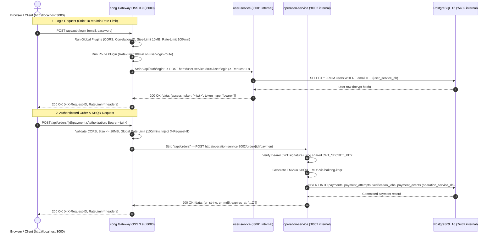

# Kong Gateway (APIM) Architecture & Operations Guide (`docs/APIM_KONG_GUIDE.md`)

> **Verified Against**: [`kong/kong.yml`](../kong/kong.yml), [`docker-compose.yml`](../docker-compose.yml), live Kong Admin API (`http://127.0.0.1:8001`), and official **Kong Gateway 3.9 Documentation**.  
> Every recommendation in this guide is marked **[MUST]**, **[SHOULD]**, or **[NICE-TO-HAVE]**.

---

## 1. What an APIM / API Gateway Is & Why This Project Uses Kong

An **API Management (APIM) Gateway** is a reverse proxy and policy enforcement layer that sits in front of backend microservices. Instead of the browser calling three separate microservices on three different ports (`8001`, `8002`, `8003`), every client request enters through **one unified gateway URL** (`http://localhost:8000`).

### Why This Project Uses Kong Gateway (`kong:3.9`)
1. **Single Entry Point**: Maps clean public paths (`/api/auth`, `/api/products`, `/api/products/{id}/images`, `/api/media`, `/api/categories`, `/api/orders`, `/api/reports`, `/health`) to internal FastAPI containers (`user-service:8001`, `operation-service:8002`, `report-service:8003`).
2. **Perimeter Security & Network Isolation**: None of the three FastAPI microservices publish ports to the Windows host (`expose` only on the internal `coffee_network` bridge). External callers cannot bypass Kong.
3. **Brute-Force & Abuse Protection (Rate Limiting)**: Enforces `100 requests/minute` globally per IP, a strict `10 requests/minute` limit on `POST /api/auth/login`, `120 requests/minute` on public `GET`-only catalog/category/product-image routes (`/api/products`, `/api/categories`, `~/api/products/[0-9]+/images`), `20 requests/minute` on staff product image upload/management (`POST`/`PATCH`/`DELETE` on `~/api/products/[0-9]+/images`), and `300 requests/minute` on public media reads (`/api/media`, `/media`) without needing Redis.
4. **Centralized CORS, Payload Limits & Tracing**: Terminates browser CORS preflight (`OPTIONS`) requests for the frontend origins only (`http://localhost:3000`, `http://127.0.0.1:3000`), caps request payloads (`10 MB` global, `6 MB` on image uploads with `KONG_NGINX_HTTP_CLIENT_MAX_BODY_SIZE: 6m`, `1 KB` on public `GET` catalog/category/media routes), and injects a unique `X-Request-ID` header into every request and response for end-to-end log correlation.

---

## 2. How Requests Flow Through Kong



---

## 3. Features Used in This Project

Every row below is verified directly against [`kong/kong.yml`](../kong/kong.yml) and [`docker-compose.yml`](../docker-compose.yml):

| Feature | Plugin or Setting | Where Configured | What It Does | Real Example from This Project |
| :--- | :--- | :--- | :--- | :--- |
| **Path Routing & Prefix Rewriting** | `services[].routes[]` with `strip_path` | `kong/kong.yml` (lines 4–244) | Matches incoming public paths on port `8000`, strips the matched prefix (`strip_path: true`, or preserves path with `strip_path: false` and `regex_priority: 200` on regex routes), and forwards the request to the internal upstream service URL. | `GET /api/orders/42/payment` matches `/api/orders` (`operation-orders-route`), strips `/api/orders`, and calls `http://operation-service:8002/order/42/payment`. |
| **Public Catalog & Category Routes (`GET`-Only)** | `operation-products-public-route`, `operation-categories-public-route`, `operation-product-images-public-route` | `kong/kong.yml` | Exposes read-only `GET`, `HEAD`, `OPTIONS` routes for listing/viewing products (`/api/products`), categories (`/api/categories`), and product image metadata (`~/api/products/[0-9]+/images`) without requiring a JWT, while enforcing `rate-limiting` (`120/min`) and `request-size-limiting` (`1 KB`). Write methods (`POST`, `PUT`, `PATCH`, `DELETE`) are separated onto dedicated write routes (`operation-products-write-route`, `operation-categories-write-route`, `operation-product-images-route`) that require staff/admin JWTs in FastAPI. | Guest `GET /api/products` returns `200 OK`; guest `POST /api/orders` returns `401 Unauthorized`. |
| **Product Image Upload Route** | `operation-product-images-route` (`~/api/products/[0-9]+/images`, `regex_priority: 200`, `strip_path: false`) | `kong/kong.yml` | Routes `POST`, `PATCH`, `DELETE` on `/api/products/{id}/images[/{image_id}]` to `operation-service:8002`, enforcing `rate-limiting` (`20/min`) and `request-size-limiting` (`6 MB`) while passing `Authorization: Bearer <jwt>` through for staff/admin RBAC. | `POST /api/products/1/images` (`multipart/form-data`) passes through Kong to `http://operation-service:8002/api/products/1/images`. |
| **Public Media Serving Route** | `operation-media-route` (`/api/media`, `/media`, `strip_path: true`, `GET`/`HEAD`/`OPTIONS`) | `kong/kong.yml` | Serves immutable product image files (`<uuid4>.<ext>`) publicly with `rate-limiting` (`300/min`) and `request-size-limiting` (`1 KB`). | `GET /api/media/3f9d...a1.jpg` strips `/api/media` and calls `http://operation-service:8002/media/3f9d...a1.jpg`. |
| **CORS Handling** | Global `cors` plugin | `kong/kong.yml` (lines 250–283) | Handles browser `OPTIONS` preflight requests (`max_age: 3600`), allows `http://localhost:3000` and `http://127.0.0.1:3000` with `credentials: true`, and exposes `X-Request-ID` & `RateLimit-*` headers. | Browser preflight `OPTIONS /api/products` with `Origin: http://localhost:3000` returns `Access-Control-Allow-Origin: http://localhost:3000`. |
| **Global Rate Limiting** | Global `rate-limiting` plugin (`policy: local`) | `kong/kong.yml` (lines 299–304) | Limits each client IP to **100 requests per minute** across general routes using Kong's in-memory shared dictionary (`lua_shared_dict`), returning `429 Too Many Requests` when exceeded. | Response includes `RateLimit-Limit: 100`, `RateLimit-Remaining: 99`, `X-RateLimit-Limit-Minute: 100`. |
| **Login Brute-Force Rate Limiting** | Route-scoped `rate-limiting` plugin (`policy: local`) | `kong/kong.yml` (lines 39–45 on `user-login-route`) | Enforces a stricter **10 requests per minute** limit specifically on `POST /api/auth/login` to stop password guessing attacks. | Sending >10 rapid `POST /api/auth/login` requests returns `HTTP 429` (`API rate limit exceeded`). |
| **Request Size Limiting & Nginx Client Max Body Size** | Global & route-scoped `request-size-limiting` plugins + `KONG_NGINX_HTTP_CLIENT_MAX_BODY_SIZE: 6m` | `kong/kong.yml` (lines 119–123, 152–156, 293–296) + `docker-compose.yml` | Caps general requests at `10 MB`, caps `~/api/products/[0-9]+/images` multipart uploads at **6 MB** (allowing a `5 MB` image + multipart overhead), and caps `/api/media` reads at **1 KB**, returning `HTTP 413 Payload Too Large` when exceeded. | Uploading a file > 5 MB/6 MB through `POST /api/products/{id}/images` returns `HTTP 413`. |
| **Correlation ID (Distributed Tracing)** | Global `correlation-id` plugin | `kong/kong.yml` (lines 286–290) | Generates a unique request ID (`generator: uuid#counter`), passes it upstream in `X-Request-ID`, and echoes it back to the client (`echo_downstream: true`). | Every response from `http://localhost:8000/*` includes `X-Request-ID: <uuid>#1`. |
| **Access & Error Logging** | `KONG_PROXY_ACCESS_LOG`, `KONG_PROXY_ERROR_LOG`, `KONG_ADMIN_ACCESS_LOG`, `KONG_ADMIN_ERROR_LOG` | `docker-compose.yml` (lines 143–146) | Streams all proxy and Admin API access logs to `/dev/stdout` and error logs to `/dev/stderr` so they can be viewed with `docker compose logs kong`. | `docker compose logs -f kong` shows HTTP method, path, status code, upstream latency, and client IP. |
| **Upstream Timeouts** | `connect_timeout`, `read_timeout`, `write_timeout` | `kong/kong.yml` (per service) | Configures fail-fast timeouts (`5000ms` connect, `15000ms` read/write on standard services; `30000ms` on `report-service` for sync jobs; `3000ms`/`5000ms` on health checks). | Prevents hung upstream connections from blocking gateway workers. |
| **Health Check Routes** | `main-health-route`, `user-health-route`, `operation-health-route`, `report-health-route` | `kong/kong.yml` (lines 126–178) | Exposes `/health` (proxied to `operation-service:8002/health`) and `/health/{user,operation,report}` for readiness monitoring and smoke tests. | `curl.exe http://localhost:8000/health` returns `{"status":"ok","service":"operation_service","database":"connected"}`. |
| **JWT Authentication Pass-Through** | `Authorization` allowed in `cors.headers`; verified in FastAPI | `kong/kong.yml` (line 204) + `*/app/dependencies/auth.py` | Kong forwards the `Authorization: Bearer <jwt>` header to the microservices, which verify the HS256 JWT signature and enforce RBAC (`customer`, `staff`, `admin`) and resource ownership. | `GET /api/auth/me` without a token returns `401 Unauthorized` from `user-service`. |

---

## 4. Features Kong Offers That This Project Does Not Use Yet (`[NICE-TO-HAVE]`)

Verified against the official Kong Gateway 3.9 plugin hub (with Open-Source vs Enterprise tiers clearly marked):

- **[NICE-TO-HAVE] Load Balancing with Upstreams & Active/Passive Health Checks (Kong OSS)**: Kong can distribute traffic across multiple replicas of `operation-service` using `upstreams` and `targets` (round-robin, consistent-hashing, or least-connections) with automatic circuit breaking. Not needed here because each service runs a single local container.
- **[NICE-TO-HAVE] Proxy Caching — `proxy-cache` (Kong OSS)**: Caches `GET` responses (such as `/api/products` or `/api/categories`) in Kong memory for a short TTL. *(Note: `proxy-cache-advanced` backed by Redis is **Kong Enterprise only**).*
- **[NICE-TO-HAVE] Request / Response Transformer — `request-transformer`, `response-transformer` (Kong OSS)**: Adds, renames, or strips headers, query strings, or body fields at the gateway layer. *(Note: `request-transformer-advanced` and `response-transformer-advanced` are **Kong Enterprise only**).*
- **[NICE-TO-HAVE] IP Restriction — `ip-restriction` (Kong OSS)**: Whitelists or blacklists specific client IP ranges (useful for restricting `/api/reports` or admin routes to internal office IPs).
- **[NICE-TO-HAVE] Bot Detection — `bot-detection` (Kong OSS)**: Inspects `User-Agent` headers to block automated scrapers.
- **[NICE-TO-HAVE] Gateway-Level JWT / Key Auth — `jwt`, `key-auth`, `oauth2` (Kong OSS) vs `openid-connect` (Kong Enterprise)**: Kong OSS includes `jwt` and `key-auth` plugins, while full **OpenID Connect (`openid-connect` / OIDC)** is **Kong Enterprise only**. In this project, JWT verification is intentionally performed inside FastAPI (`get_current_user`) so routes can enforce domain-level checks (e.g., verifying that `order.user_id == current_user.id`) without duplicating static consumer keys in `kong.yml`.
- **[NICE-TO-HAVE] Prometheus Metrics — `prometheus` (Kong OSS)**: Exposes `/metrics` on the Admin/Status API for scraping latency histograms, status codes, and bandwidth into Prometheus/Grafana.
- **[NICE-TO-HAVE] Mutual TLS (`mtls-auth`)**: Full client-certificate consumer mapping via the `mtls-auth` plugin is **Kong Enterprise only** (Kong OSS supports basic TLS termination via `certificates` and `snis`).

---

## 5. What Kong Stores and Manages

### Important Architectural Note: DB Mode vs DB-less Declarative Mode in This Project
- **What the project actually runs**: In [`docker-compose.yml`](../docker-compose.yml) (lines 141–142), Kong is configured with `KONG_DATABASE: "off"` and `KONG_DECLARATIVE_CONFIG: /kong/declarative/kong.yml` (**DB-less declarative mode**). When Kong boots, it reads [`kong/kong.yml`](../kong/kong.yml) and stores all gateway entities in Kong's internal in-memory LMDB cache (`kong_db_cache`).
- **How this compares to Kong PostgreSQL DB Mode**: In traditional Kong DB mode (`KONG_DATABASE=postgres`), Kong stores those exact same core entities in a dedicated `kong` database inside PostgreSQL and mutates them via `POST`/`PATCH`/`DELETE` calls to the Admin API (`:8001`). We chose DB-less mode (`kong/kong.yml`) so the entire gateway configuration is version-controlled in Git, starts instantaneously without database migration race conditions, and requires zero database maintenance.
- **[MUST] Separation of Configuration vs Business Data**:
  **Kong ONLY stores its own gateway configuration (services, routes, plugins, consumers). Kong NEVER stores the coffee shop's business data.** All users (`user_service_db`), products, categories, stock movements, orders, and Bakong KHQR payments (`operation_service_db`), and analytics snapshots (`report_service_db`) live exclusively in the microservice PostgreSQL databases.

### Core Kong Entities (Data Model & Project Usage)

Verified via read-only Admin API queries against `http://127.0.0.1:8001` (`/services`, `/routes`, `/plugins`, `/consumers`, `/upstreams`, `/certificates`):

| Kong Entity | What It Holds (in `kong.yml` or `kong` Postgres DB) | Active Count in This Project | Real Examples in This Project (`kong/kong.yml`) |
| :--- | :--- | :--- | :--- |
| **`services`** | Upstream backend APIs that Kong forwards traffic to (name, protocol, host, port, path, connect/read/write timeouts, retries). | **12** | `user-service` (`http://user-service:8001/user`), `user-login-service` (`http://user-service:8001/user/login`), `operation-service-orders` (`http://operation-service:8002/order`), `operation-service-products` (`http://operation-service:8002/product`), `operation-service-product-images` (`http://operation-service:8002`), `operation-service-media` (`http://operation-service:8002/media`), `operation-service-categories` (`http://operation-service:8002/category`), `report-service` (`http://report-service:8003/report`), plus 4 health services (`main-health-service`, `user-health-service`, `operation-health-service`, `report-health-service`). |
| **`routes`** | Ingress matching rules attached to a Service (name, `paths`, `methods`, `strip_path`, `preserve_host`, `regex_priority`, protocols). | **15** | `user-auth-route` (`/api/auth`), `user-login-route` (`/api/auth/login`), `operation-orders-route` (`/api/orders`), `operation-products-public-route` (`GET` `/api/products`), `operation-products-write-route` (`POST`/`PUT`/`PATCH`/`DELETE` `/api/products`), `operation-product-images-public-route` (`GET` `~/api/products/[0-9]+/images`), `operation-product-images-route` (`POST`/`PATCH`/`DELETE` `~/api/products/[0-9]+/images`), `operation-media-route` (`/api/media`, `/media`), `operation-categories-public-route` (`GET` `/api/categories`), `operation-categories-write-route` (`POST`/`PUT`/`DELETE` `/api/categories`), `report-routes` (`/api/reports`), `main-health-route` (`/health`), `user-health-route` (`/health/user`), `operation-health-route` (`/health/operation`), `report-health-route` (`/health/report`). |
| **`plugins`** | Policy configurations executed during the request/response lifecycle (global, service-scoped, route-scoped, or consumer-scoped). | **15** (4 global + 11 route-scoped) | Global: `cors`, `correlation-id`, `request-size-limiting` (10 MB), `rate-limiting` (100/min).<br>Route-scoped: `rate-limiting` (10/min on `user-login-route`), `rate-limiting` (120/min) + `request-size-limiting` (1 KB) on `operation-products-public-route`, `operation-product-images-public-route`, and `operation-categories-public-route`, `rate-limiting` (20/min) + `request-size-limiting` (6 MB) on `operation-product-images-route`, `rate-limiting` (300/min) + `request-size-limiting` (1 KB) on `operation-media-route`. |
| **`consumers`** | Represents an individual user or external client application interacting with Kong (used when Kong manages API keys or gateway-level rate tiers). | **0** | Not used; user accounts live in `user_service_db.users` and authenticate via FastAPI JWT dependencies. |
| **`credentials` (`jwt`, `key-auth`, `basic-auth`)** | Secret keys, API keys, or RSA/HMAC public keys associated with a Kong `consumer`. | **0** | Not stored in Kong; `JWT_SECRET_KEY` is stored only in the backend `.env` files. |
| **`upstreams` & `targets`** | Virtual hostname (`upstream`) and list of IP/port backend instances (`targets`) with active/passive health check thresholds for load balancing. | **0** | Not used; Docker Compose internal DNS resolves `user-service`, `operation-service`, and `report-service` directly. |
| **`certificates` & `snis`** | TLS/SSL x509 public/private key pairs and Server Name Indication (`SNI`) hostnames for HTTPS termination at Kong. | **0** | Local stack runs over HTTP on `127.0.0.1:8000`. |
| **`tags`** | Optional metadata labels attached to any entity for filtering in the Admin API. | **0** | Optional organizational metadata. |

---

## 6. What Kong Manages at Runtime

When the `kong` container is running, its Nginx + OpenResty worker processes manage:

1. **Request Routing & Path Rewriting**: Evaluates incoming HTTP method + URI against the in-memory route table, strips the public prefix (`strip_path: true`), and proxies the request to the matching Docker service container (`http://user-service:8001`, `http://operation-service:8002`, or `http://report-service:8003`).
2. **Rate Limit Counters (`policy: local` — No Redis)**:
   - Configured with `policy: local` and `fault_tolerant: true` in `kong/kong.yml`.
   - Counters are stored in Kong's in-memory Nginx shared dictionary (`lua_shared_dict` `kong_rate_limiting_counters`), keyed by client IP address and minute window.
   - *(Note: Kong also supports `policy: postgres` in DB mode and `policy: redis` when an external Redis cluster is used; `local` requires zero external dependencies and has sub-millisecond overhead).*
3. **Authentication Header Forwarding**: Allows `Authorization` headers through CORS preflight checks and forwards `Authorization: Bearer <token>` untouched to upstream FastAPI services.
4. **Request & Response Headers**:
   - Injects `X-Request-ID` (`uuid#counter`) into upstream requests and downstream responses.
   - Injects `RateLimit-Limit`, `RateLimit-Remaining`, `RateLimit-Reset`, `X-RateLimit-Limit-Minute`, and `X-RateLimit-Remaining-Minute` headers.
   - Injects `Access-Control-Allow-Origin`, `Access-Control-Allow-Credentials: true`, and `Access-Control-Expose-Headers`.
5. **Access & Error Logs**: Writes structured HTTP access logs for every proxied request to `stdout` and upstream connection/timeout errors to `stderr`.

---

## 7. Ports and Access Control

| Port | Purpose | Container Listen Setting | Host Port Binding (`docker-compose.yml`) | Public or Localhost Only? |
| :--- | :--- | :--- | :--- | :--- |
| **`8000`** | **Kong Proxy Port** (All client API calls) | `KONG_PROXY_LISTEN: 0.0.0.0:8000` | `127.0.0.1:8000:8000` | Bound to `127.0.0.1` loopback on Windows host |
| **`8001`** | **Kong Admin API** (Inspection & reload) | `KONG_ADMIN_LISTEN: 0.0.0.0:8001` | `127.0.0.1:8001:8001` | **[MUST] Localhost (`127.0.0.1`) ONLY — Never Public** |
| **`8002`** | **Kong Manager GUI** *(Not enabled in this stack)* | Disabled (`operation-service` uses internal `:8002`) | Not published | **[MUST] Never Public** |

> [!CAUTION]
> **Why Port `8001` (Admin API) and `8002` (Kong Manager) Must Never Be Public**:  
> Kong's Admin API (`:8001`) has full administrative control over the gateway without built-in authentication in Kong OSS. Anyone who can reach port `8001` can inspect all routes/plugins, reload configurations, or—in DB mode—add rogue routes and steal credentials. Always keep port `8001` bound strictly to `127.0.0.1:8001:8001` on the host.

---

## 8. How to Change Kong Configuration

### Source of Truth
The single source of truth for Kong is [`kong/kong.yml`](../kong/kong.yml) (`D:\Study\Year-4\Python\coffee_shop\kong\kong.yml`), which is mounted into the `kong` container at `/kong/declarative/kong.yml:ro`.

### Exact Commands to Validate, Apply, and Verify Changes

```powershell
# 1. Edit kong/kong.yml on your Windows host
notepad D:\Study\Year-4\Python\coffee_shop\kong\kong.yml

# 2. Validate syntax inside the running Kong container before reloading
docker compose exec kong kong config parse /kong/declarative/kong.yml

# 3. Hot-reload Kong in-place (zero downtime)
docker compose exec kong kong reload

#    (Note: On Windows bind mounts, if in-place file inode updates are cached by WSL2,
#     recreate the kong container so it mounts the updated file cleanly:)
docker compose up -d --force-recreate kong

# 4. Verify the updated routes and plugins via the localhost Admin API
(Invoke-RestMethod -Uri "http://127.0.0.1:8001/routes").data | Select-Object name, paths, methods
(Invoke-RestMethod -Uri "http://127.0.0.1:8001/plugins").data | Select-Object name, enabled
```

---

## 9. How to Check Kong Is Healthy and Read Its Logs

```powershell
# 1. Check Docker health status of the kong container
docker compose ps kong

# 2. Run Kong's internal CLI health check
docker compose exec kong kong health

# 3. Query the Admin API status endpoint (memory cache & connection metrics)
curl.exe -s http://127.0.0.1:8001/status | ConvertFrom-Json

# 4. Test the proxied health endpoint through port 8000
curl.exe -i http://localhost:8000/health

# 5. Stream real-time Kong access and error logs
docker compose logs -f --tail 50 kong
```

---

## 10. Kong Troubleshooting Table

| Error / Symptom | HTTP Code | Root Cause | Verified Fix |
| :--- | :--- | :--- | :--- |
| `{"message":"no Route matched with those values"}` | **`404 Not Found`** (from Kong) | Calling an internal microservice path directly (e.g., `/product` or `/order`) instead of the Kong route prefix (`/api/products` or `/api/orders`), or using an HTTP method not listed in `methods`. | Check the route paths in `kong/kong.yml` (`/api/auth`, `/api/products`, `/api/categories`, `/api/orders`, `/api/reports`, `/health`). |
| `{"success":false,"error_code":"err_401_unauthorized","message":"Missing bearer token"}` | **`401 Unauthorized`** (from FastAPI via Kong) | Calling a protected route (`/api/auth/me`, `/api/orders`, `/api/reports`) without an `Authorization: Bearer <token>` header, or `JWT_SECRET_KEY` differs across services. | Obtain a token from `POST /api/auth/login`, pass `Authorization: Bearer <token>`, and ensure `JWT_SECRET_KEY` is identical in `user_service/.env`, `operation_service/.env`, and `report_service/.env`. |
| `{"message":"API rate limit exceeded"}` | **`429 Too Many Requests`** | Client exceeded `10 requests/minute` on `POST /api/auth/login` or `100 requests/minute` globally. | Inspect the `RateLimit-Reset` response header (seconds until the current minute window resets) and wait up to 60 seconds, or adjust `minute:` in `kong/kong.yml` and reload Kong. |
| `An invalid response was received from the upstream server` | **`502 Bad Gateway`** | Target FastAPI container (`user-service:8001`, `operation-service:8002`, or `report-service:8003`) is stopped, crashed, or unreachable on `coffee_network`. | Run `docker compose ps` and `docker compose logs --tail 50 <service>` to find why the microservice failed, then run `docker compose up -d <service>`. |
| `The upstream server is timing out` | **`504 Gateway Timeout`** | Upstream service took longer than `read_timeout` (`15000ms` default, `30000ms` for `report-service`), e.g., slow outbound network call or locked DB row. | Check `docker compose logs --tail 50 operation-service` or `report-service`. Increase `read_timeout` in `kong/kong.yml` if needed. |
| Browser console: `Access to XMLHttpRequest at 'http://localhost:8000/...' from origin 'http://localhost:3000' has been blocked by CORS policy` | **CORS Error** | Frontend accessed via an origin not listed in `kong/kong.yml` `plugins[name=cors].config.origins` (e.g., a LAN IP or custom tunnel domain). | Open the frontend via `http://localhost:3000` (or `http://127.0.0.1:3000`), or add your custom origin to `origins:` in `kong/kong.yml` and run `docker compose up -d --force-recreate kong`. |
| **Route not found after editing `kong/kong.yml`** | **`404 Not Found`** | Kong was not reloaded after editing `kong/kong.yml`, or Windows NTFS inode replacement prevented the bind mount from updating inside the container. | Run `docker compose exec kong kong config parse /kong/declarative/kong.yml` to check for YAML syntax errors, then run `docker compose up -d --force-recreate kong`. |
| **Plugin not applied to a route** | N/A | Plugin was indented under `services` instead of top-level `plugins:` (for global) or `routes[].plugins:` (for route-specific) in `kong/kong.yml`. | Verify plugin placement in `kong/kong.yml` and check active plugins via `(Invoke-RestMethod -Uri "http://127.0.0.1:8001/plugins").data`. |
