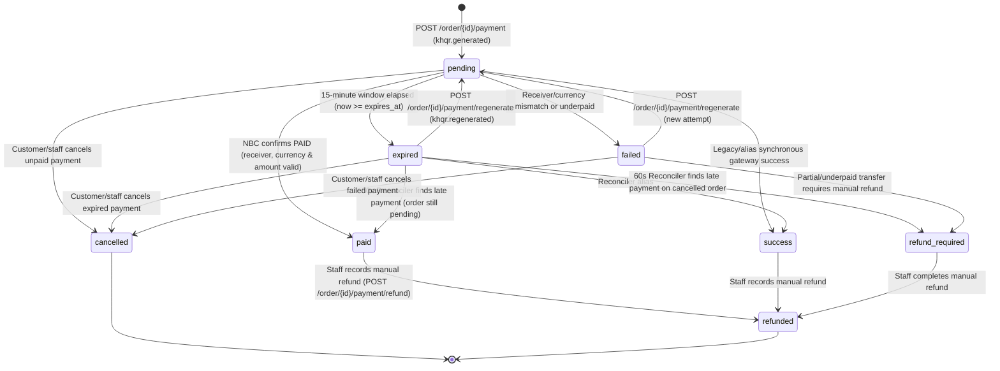

# Bakong & KHQR Payment Integration Guide (`docs/BAKONG_KHQR_GUIDE.md`)

> **Environment**: Windows 10/11 + Docker Desktop (WSL2 Engine) + FastAPI (`operation_service`) + `bakong-khqr==0.6.5` + Next.js 15 (`coffee_shop_frontend`).
> All recommendations in this guide are marked with **[MUST]**, **[SHOULD]**, or **[NICE-TO-HAVE]**.

---

## Table of Contents

1. [What Bakong and KHQR Are](#1-what-bakong-and-khqr-are)
2. [What Bakong Provides and Manages (vs What It Does Not)](#2-what-bakong-provides-and-manages-vs-what-it-does-not)
3. [What This Application Does](#3-what-this-application-does)
4. [What This Application Stores in PostgreSQL](#4-what-this-application-stores-in-postgresql)
5. [Payment Flow (Mermaid Sequence Diagram)](#5-payment-flow-mermaid-sequence-diagram)
6. [Payment State Machine](#6-payment-state-machine)
7. [Configuration & Fail-Fast Validation](#7-configuration--fail-fast-validation)
8. [Security and Money Safety](#8-security-and-money-safety)
9. [Product Share Links & Open Graph Previews](#9-product-share-links--open-graph-previews)
10. [Manual Real-Payment Test Checklist](#10-manual-real-payment-test-checklist)
11. [Troubleshooting Table](#11-troubleshooting-table)

---

## 1. What Bakong and KHQR Are

- **Bakong** is Cambodia's national retail payment and interbank settlement system operated by the **National Bank of Cambodia (NBC)**. It connects commercial banks, microfinance institutions, and payment service providers across Cambodia on a unified ledger.
- **KHQR** is the universal EMVCo-compliant Quick Response (QR) code standard created by NBC for cross-bank payments in Cambodia. Any customer with a Cambodian mobile banking app (**Bakong App**, **ABA Mobile**, **ACLEDA Mobile**, **Wing Bank**, **Sathapana**, **Canadia Bank**, etc.) can scan a single KHQR code to pay a merchant in **US Dollars (`USD`)** or **Cambodian Riel (`KHR`)**.

---

## 2. What Bakong Provides and Manages (vs What It Does Not)

Understanding the boundary between what the **NBC Bakong network** manages and what **this Coffee Shop application** manages is essential for operating and debugging payments safely.

### 2.1 What NBC Bakong Provides and Manages

| Capability / Resource | Provided By | Verified Details in This Project |
| :--- | :--- | :--- |
| **Merchant Account & Bakong Account ID** | NBC Bakong & Member Bank | Your registered Bakong recipient account identifier (`BAKONG_ACCOUNT_ID`, formatted as `merchant_username@bank_code`, e.g., `<your-account>@aba` or `<your-account>@aclb`). Embedded into EMVCo Tag `29` (Individual) or Tag `30` (Merchant). |
| **Developer API Token (`BAKONG_TOKEN`) & Renewal** | NBC Bakong Developer Portal (`https://api-bakong.nbc.gov.kh/`) | A Bearer JWT issued to registered developers/merchants. Tokens have a **30-to-90-day expiry lifetime**. Can be renewed via the portal or `POST /v1/renew_token` using `BAKONG_REGISTERED_EMAIL`. |
| **Transaction Check API (Single & Bulk by MD5)** | NBC Bakong Open API v1 (or `api.khqr.dev` Relay if using an `rbk...` token) | - `POST /v1/check_transaction_by_md5` (wrapped by `KHQR.check_payment(md5)` and `KHQR.get_payment(md5)`).<br>- `POST /v1/check_transaction_by_md5_list` (wrapped by `KHQR.check_bulk_payments(md5_list)`, up to 50 MD5 hashes per call).<br>Returns settlement status (`PAID` / `UNPAID`) and transaction details (`hash`, `fromAccountId`, `toAccountId`, `currency`, `amount`, `createdDateMs`, `acknowledgedDateMs`). |
| **Mobile App Deeplink Generation** | NBC Bakong Open API (`/v1/generate_deeplink_by_qr`) | Wrapped by `KHQR.generate_deeplink(...)`; returns a shortlink (`https://bakong.nbc.gov.kh/...`) that opens the Bakong mobile app directly on mobile devices. |
| **Real-Money Settlement** | NBC Bakong & Member Banks | When a customer scans the KHQR and confirms in their banking app, funds are settled **directly and immediately** from the customer's bank account into your merchant bank account (`BAKONG_ACCOUNT_ID`). |
| **API Rate Limits** | NBC Bakong Open API | Enforces per-IP and per-token request rate limits (HTTP `429`). This project mitigates rate limits using staged polling backoff (`3s -> 5s -> 10s -> 15s`) and bulk MD5 checks (`check_bulk_payments`) when multiple jobs are queued. |
| **Cambodia-Only IP Filtering (Geo-Restriction)** | NBC Bakong Production API | Production NBC Bakong API endpoints enforce Cambodian IP geo-filtering (rejecting non-Cambodian IPs with HTTP `403`). **Docker Desktop on Windows (WSL2)** routes outbound container traffic through the Windows host network stack via NAT, so containers share your Windows host's Cambodian public IP and work without a VPN or proxy. |

### 2.2 What Bakong and `bakong-khqr==0.6.5` Do NOT Provide

- **No Push Webhooks**: Neither the NBC Bakong Open API v1 nor the `bakong-khqr==0.6.5` Python SDK provides push webhooks to notify your local server when a QR is paid. Verification **must** be performed by polling `check_transaction_by_md5` / `check_transaction_by_md5_list`.
- **No Programmatic Refund API**: Neither `bakong-khqr==0.6.5` nor the NBC Bakong Open API v1 exposes an automated refund or reversal endpoint. Once a customer transfers funds via KHQR, the settlement is final on the Bakong network. Any refund (`refund_required` / `refunded`) must be transferred manually by merchant staff through their banking app and recorded in the Coffee Shop system via `POST /api/orders/{id}/payment/refund` with the external bank reference (`external_refund_ref`).
- **No Minute-Granularity Expiry in `bakong-khqr` `create_qr()`**: The `bakong-khqr` SDK's `create_qr(..., expiration=1)` parameter accepts integer **days**, whereas coffee shop orders expire in **15 minutes** (`PAYMENT_EXPIRY_MINUTES=15`). Therefore, the 15-minute expiration window is enforced by this application in PostgreSQL (`payments.expires_at`) and in the frontend countdown timer.

---

## 3. What This Application Does

Implemented across `operation_service/app/services/bakong_khqr.py`, `operation_service/app/services/payment_service.py`, `operation_service/app/main.py`, and `coffee_shop_frontend/src/features/payment/components/pay-dialog.tsx`:

1. **Generates Dynamic EMVCo KHQR Locally**:
   - Validates that the order is in `pending` status and the amount is within the safety guardrail (`$0.01 <= amount <= BAKONG_MAX_AMOUNT_USD` for `USD`, or `100 KHR <= amount <= BAKONG_MAX_AMOUNT_USD * BAKONG_USD_TO_KHR_RATE` for integer `KHR`).
   - Calls `RealBakongClient.create_qr()` (wrapping `KHQR(bakong_token).create_qr(...)`) to construct an EMVCo TLV payload containing Tag `00` (Format `01`), Tag `01` (`12` Dynamic QR), Tag `29` (`BAKONG_ACCOUNT_ID`), Tag `52` (MCC `5814`), Tag `53` (Currency `840` USD / `116` KHR), Tag `54` (Amount), Tag `58` (`KH`), Tag `59` (`BAKONG_MERCHANT_NAME`), Tag `60` (`BAKONG_MERCHANT_CITY`), Tag `62` (Bill Number `ORD-{order_id}-A{attempt}`, Store & Terminal labels), Tag `99` (Creation & Expiry timestamps), and Tag `63` (CRC16-CCITT checksum).
2. **Computes the 32-Character MD5 Digest**:
   - Computes the lowercase hexadecimal MD5 digest (`qr_md5`) of the exact UTF-8 KHQR string (`hashlib.md5(qr_string.encode("utf-8")).hexdigest().lower()`). This `qr_md5` is the lookup key NBC Bakong uses to track settlement of that specific QR code.
3. **Requests a Mobile Deeplink (Best-Effort)**:
   - Calls `RealBakongClient.generate_deeplink()` with callback URL `{PUBLIC_BASE_URL}/orders/{order_id}`. If offline or unreachable, `deeplink_url` degrades gracefully to `None` while the QR code itself remains 100% functional.
4. **Renders Vector SVG QR & Live Countdown in the Browser**:
   - `pay-dialog.tsx` renders `qr_string` as a crisp vector SVG using `qrcode.react` (`<QRCodeSVG />`), displays a live 15-minute UTC countdown badge (`expires_at` serialized with trailing `"Z"`), provides an **"Open in Bakong / Banking App"** button when `deeplink_url` is present, and polls `GET /api/orders/{id}/payment` every 3 seconds while the modal is open.
5. **Polls NBC Bakong with Backoff via PostgreSQL `SKIP LOCKED` Worker**:
   - On startup (`operation_service/app/main.py`), FastAPI launches a daemon thread (`bakong-verification-worker`) that runs `PaymentVerificationWorker.process_due_jobs()` every 3 seconds.
   - The worker claims queued rows from `verification_jobs` using `SELECT ... FOR UPDATE SKIP LOCKED` and checks NBC Bakong using adaptive backoff (`compute_poll_backoff_seconds`):
     - Attempts `1–10`: every **3 seconds**
     - Attempts `11–20`: every **5 seconds**
     - Attempts `21–30`: every **10 seconds**
     - Attempts `31–40`: every **15 seconds** (moves to `dead_letter` after `max_attempts=40` if not already expired)
   - When multiple jobs are due simultaneously, the worker batches them into `check_transaction_by_md5_list` (chunks of up to 50 MD5s) to conserve API rate limits.
   - Once NBC returns `PAID`, the worker verifies that `toAccountId == receiver_account`, `currency` matches, and `paid_amount >= expected_amount` before marking both the `Payment` and `Order` as `paid`.
6. **Reconciles Late Payments Every 60 Seconds**:
   - Every 60 seconds, the background thread runs `worker.reconcile_expired_payments(db, lookback_minutes=30)` to check recently expired QRs in case a customer scanned right before the 15-minute timer ended and confirmed slightly after.

---

## 4. What This Application Stores in PostgreSQL

All payment records live in the **`operation_service_db`** PostgreSQL database (defined in `operation_service/app/models/payment.py`).

> [!IMPORTANT]
> **`BAKONG_TOKEN` is NEVER stored in PostgreSQL, never returned in API responses, and never sent to the frontend.** It exists only in `operation_service` process memory loaded from `.env`. Customer payer accounts returned by Bakong (`fromAccountId`) are always masked via `mask_bakong_account()` (e.g., `so***an@aba`) before being written to `payments` or `payment_attempts`.

### 4.1 Database Tables Overview (`operation_service_db`)

| Table Name | SQLAlchemy Model | Purpose |
| :--- | :--- | :--- |
| `payments` | `Payment` | Primary 1-to-1 payment record per `order_id`. Holds current status, latest `qr_string`, `qr_md5`, `expires_at`, `paid_at`, `bakong_transaction_hash`, and masked payer account. |
| `payment_attempts` | `PaymentAttempt` | 1-to-many history of every QR generation/regeneration attempt (`ORD-{order_id}-A{n}`) for an order, including `raw_bakong_response` on settlement. |
| `payment_events` | `PaymentEvent` | Immutable append-only audit log recording every state transition (`khqr.generated`, `khqr.regenerated`, `payment.paid`, `payment.expired`, `payment.cancelled`, `payment.refunded`, `payment.conflict_refund_required`, etc.). |
| `verification_jobs` | `VerificationJob` | PostgreSQL `SELECT ... FOR UPDATE SKIP LOCKED` background polling queue indexed by `status` and `next_run_at`. |
| `refunds` | `Refund` | Records manual/off-gateway refunds (overpayments, underpayments, duplicate payments, late payments on cancelled orders, or staff-initiated refunds). |
| `idempotency_keys` | `IdempotencyRecord` | Schema table provisioned for idempotency key tracking (`uq_idempotency_key_user_endpoint`). |

### 4.2 Detailed Columns, Sensitivity & Masking Rules

| Table.Column | Type | Purpose | Sensitive? | Masking / Protection Rule |
| :--- | :--- | :--- | :--- | :--- |
| `payments.order_id` | `Integer` (FK, Unique) | Links payment 1-to-1 with `orders.id`. | No | Enforced by ownership check (`_ensure_owner_or_staff`). |
| `payments.amount` / `currency` | `Numeric(12,2)` / `String(3)` | Expected settlement amount and currency (`USD` or `KHR`). | No | Validated against `BAKONG_MAX_AMOUNT_USD`. |
| `payments.status` | `String(24)` | Current lifecycle status (`pending`, `paid`, `expired`, `failed`, `cancelled`, `refund_required`, `refunded`). | No | Validated via `PaymentStatus.TRANSITIONS`. |
| `payments.transaction_ref` | `String(64)` | Starts as bill number (`ORD-{id}-A{n}`), updated to `bakong_transaction_hash[:64]` when paid. | Low | Masked in logs via `mask_secret()` (`...last4`). |
| `payments.qr_string` | `Text` | Raw EMVCo TLV KHQR payload rendered by the frontend QR component. | Low (contains `receiver_account`) | Visible only to the order owner or `staff`/`admin`. |
| `payments.qr_md5` | `String(32)` (Unique) | 32-char lowercase hex MD5 of `qr_string` used to poll NBC Bakong. | Low | Masked in logs as `...last4` (`mask_secret`) and in UI as `...last8`. |
| `payments.deeplink_url` | `String(512)` | NBC Bakong mobile app shortlink. | No | Optional (`Nullable`). |
| `payments.expires_at` / `paid_at` | `DateTime` (UTC) | QR expiration timestamp and settlement confirmation timestamp. | No | Serialized as ISO-8601 UTC with `"Z"` suffix in API responses. |
| `payments.bakong_transaction_hash` | `String(128)` (Unique) | Official Bakong settlement hash (`data.hash`). Prevents duplicate credit. | Medium | Masked in logs via `mask_secret()` (`...last4`). |
| `payments.payer_account_masked` | `String(64)` | Masked customer Bakong account (`fromAccountId`). | **Yes (PII)** | **Always masked before DB insert** via `mask_bakong_account()` (e.g., `sokha_chan@aba` -> `so***an@aba`). |
| `payments.receiver_account` | `String(64)` | Merchant `BAKONG_ACCOUNT_ID` expected to receive funds. | Medium | Not exposed in `PaymentResponse` schema; masked in logs via `mask_secret()`. |
| `payment_attempts.raw_bakong_response` | `Text` | JSON snapshot of Bakong verification payload for audit reconciliation. | **Yes** | Stored in DB only (`payment_attempts` is never returned in API responses). |
| `payment_events.event_type` / `actor` | `String(64)` | Audit trail event name and actor (`customer:12`, `worker-1`, `reconciler`, `staff:1`). | No | Internal audit log table. |
| `verification_jobs.qr_md5` / `next_run_at` | `String(32)` / `DateTime` | Polling queue key, attempt counter (`attempt_count`/`max_attempts=40`), and lock metadata (`locked_by`, `locked_at`). | Low | Internal worker queue; never exposed via API. |
| `refunds.external_refund_ref` | `String(128)` | Reference ID from the merchant's manual bank transfer when refunding a customer. | Low | Recorded by `admin`/`staff` via `POST /order/{id}/payment/refund`. |

---

## 5. Payment Flow (Mermaid Sequence Diagram)

The diagram below shows all three real execution paths implemented in `operation_service`:
1. **Happy Path**: Customer scans and pays within 15 minutes.
2. **Expired & Regenerated Path**: Customer waits longer than 15 minutes (`payment.expired`) and clicks **Regenerate KHQR**.
3. **Late-Payment Reconciliation Path**: Customer scans right before expiry, the QR marks `expired`, and the 60-second reconciler detects the settlement (`paid` if order is still `pending`, or `refund_required` if the order was cancelled in the meantime).

```mermaid
sequenceDiagram
    autonumber
    actor Customer
    participant FE as Next.js Frontend (PayDialog)
    participant Kong as Kong Gateway (:8000)
    participant Op as operation_service (FastAPI + Worker)
    participant DB as PostgreSQL (operation_service_db)
    participant NBC as NBC Bakong Open API

    Note over Customer,NBC: 1. Order Creation & Dynamic KHQR Generation
    Customer->>FE: Click "Checkout" / "Pay with Bakong KHQR"
    FE->>Kong: POST /api/orders (create order, status="pending")
    Kong->>Op: POST /order
    Op->>DB: INSERT orders (status="pending")
    Op-->>FE: 201 Created (order_id)

    FE->>Kong: POST /api/orders/{id}/payment {method:"khqr", currency:"USD"}
    Kong->>Op: POST /order/{id}/payment
    Op->>Op: Validate amount <= BAKONG_MAX_AMOUNT_USD ($1.00)<br/>Generate EMVCo KHQR + compute 32-char qr_md5
    Op->>NBC: generate_deeplink(qr_string) (best-effort)
    NBC-->>Op: shortLink (or None)
    Op->>DB: INSERT payments (status="pending", expires_at=now+15m)<br/>INSERT payment_attempts (ORD-{id}-A1)<br/>INSERT verification_jobs (status="queued", next_run_at=now)<br/>INSERT payment_events ("khqr.generated")
    Op-->>FE: 200 OK (qr_string, qr_md5, deeplink_url, expires_at="...Z")
    FE->>Customer: Render <QRCodeSVG /> + 15:00 countdown + poll GET /payment every 3s

    alt Path A: Customer Scans & Pays Within 15 Minutes
        Customer->>NBC: Scan KHQR in ABA / ACLEDA / Bakong App & confirm transfer
        loop Every 3s..15s (SELECT ... FOR UPDATE SKIP LOCKED)
            Op->>DB: Claim due VerificationJob
            Op->>NBC: check_payment(qr_md5) & get_payment(qr_md5)
            NBC-->>Op: status="PAID", data={hash, fromAccountId, toAccountId, amount, currency}
            Op->>Op: Verify toAccountId == receiver_account, currency, amount >= expected
            Op->>DB: UPDATE payments SET status="paid", bakong_transaction_hash, payer_account_masked<br/>UPDATE orders SET status="paid"<br/>UPDATE verification_jobs SET status="completed"<br/>INSERT payment_events ("payment.paid")
        end
        FE->>Kong: GET /api/orders/{id}/payment
        Kong-->>FE: status="paid", bakong_transaction_hash
        FE->>Customer: Show "Payment Verified!" & invalidate order cache

    else Path B: 15 Minutes Elapse Without Payment (Expiry & Regenerate)
        Op->>DB: now >= payment.expires_at -> UPDATE payments SET status="expired"<br/>UPDATE verification_jobs SET status="completed"<br/>INSERT payment_events ("payment.expired")
        FE->>Customer: Badge shows "QR Expired" + "Regenerate KHQR" button
        Customer->>FE: Click "Regenerate KHQR"
        FE->>Kong: POST /api/orders/{id}/payment/regenerate
        Kong->>Op: POST /order/{id}/payment/regenerate (force_regenerate=True)
        Op->>DB: Mark prior attempt expired; create attempt ORD-{id}-A2 + new qr_md5 + new VerificationJob

    else Path C: Late Settlement Arrives After QR Marked Expired (60s Reconciler)
        Customer->>NBC: Scanned before expiry, confirmed transfer a few seconds after expires_at
        loop Every 60s (reconcile_expired_payments, lookback=30m)
            Op->>DB: SELECT expired payments updated within last 30m
            Op->>NBC: check_transaction_by_md5(qr_md5)
            NBC-->>Op: found=True (PAID)
            alt Order is still "pending"
                Op->>DB: Transition payment "expired" -> "paid" & order -> "paid"<br/>INSERT payment_events ("payment.paid", actor="reconciler")
            else Order was already "cancelled"
                Op->>DB: Transition payment "expired" -> "refund_required"<br/>INSERT refunds (reason="late_payment_on_cancelled_order", status="pending_manual")<br/>INSERT payment_events ("payment.conflict_refund_required")
            end
        end
    end
```

---

## 6. Payment State Machine

Defined in `operation_service/app/models/payment.py` (`PaymentStatus.TRANSITIONS`):



### Exact Allowed Transitions Table (`PaymentStatus.TRANSITIONS`)

| Current Status | Allowed Next Statuses | Triggering Actions in Code |
| :--- | :--- | :--- |
| `pending` | `paid`, `success`, `failed`, `expired`, `cancelled` | Worker/manual verify confirms settlement (`paid`), validation fails (`failed`), `now >= expires_at` (`expired`), or `POST /cancel` (`cancelled`). |
| `expired` | `pending`, `paid`, `success`, `refund_required`, `cancelled` | `POST /regenerate` (`pending`), 60s late-payment reconciler when order is still pending (`paid`), reconciler when order was cancelled (`refund_required`), or `POST /cancel` (`cancelled`). |
| `failed` | `pending`, `cancelled`, `refund_required` | `POST /regenerate` (`pending`), `POST /cancel` (`cancelled`), or failed payment requiring manual return of funds (`refund_required`). |
| `paid` | `refunded` | `admin` or `staff` calls `POST /order/{id}/payment/refund` with `amount`, `reason`, and `external_refund_ref`. |
| `success` | `refunded` | Backward-compatible alias for `paid`; transitions to `refunded` on staff refund. |
| `refund_required` | `refunded` | `admin` or `staff` completes the manual bank refund and records it via `POST /order/{id}/payment/refund`. |
| `cancelled` | *(terminal — `set()`)* | No further transitions allowed. |
| `refunded` | *(terminal — `set()`)* | No further transitions allowed. |

---

## 7. Configuration & Fail-Fast Validation

### 7.1 Environment Variable Reference

All backend payment settings are defined in `operation_service/app/core/config.py` (`Settings` class) and injected into the `operation-service` container via `docker-compose.yml` (reading from `.env` and `operation_service/.env`):

| Variable Name | Default Value | Where It Is Read | Purpose |
| :--- | :--- | :--- | :--- |
| `BAKONG_TOKEN` | `None` *(Required)* | `operation_service/app/core/config.py`, `RealBakongClient.__init__` | NBC Bakong Open API Bearer JWT token (or `rbk...` Relay token). **Required at startup when `ENVIRONMENT != "test"`.** |
| `BAKONG_ACCOUNT_ID` | `None` *(Required)* | `operation_service/app/core/config.py`, `PaymentService`, `RealBakongClient` | Registered merchant Bakong account ID (`<merchant>@<bank>`). **Required at startup when `ENVIRONMENT != "test"`.** |
| `BAKONG_API_BASE_URL` | `https://sit-api-bakong.nbc.gov.kh` | `operation_service/app/core/config.py`, `RealBakongClient` | Base URL for direct HTTPX calls (`/v1/renew_token`, `/v1/check_transaction_by_md5`). Note: `bakong-khqr` SDK automatically routes standard tokens to `https://api-bakong.nbc.gov.kh/v1` and `rbk...` tokens to `https://api.khqr.dev/v1`. |
| `BAKONG_REGISTERED_EMAIL` | `None` | `operation_service/app/core/config.py`, `RealBakongClient.renew_token` | Email address registered in the NBC Bakong Developer Portal; used by `/v1/renew_token`. |
| `BAKONG_MERCHANT_NAME` | `"Coffee Shop"` | `operation_service/app/core/config.py`, `RealBakongClient.create_qr` | Merchant display name encoded into EMVCo Tag `59` (max 25 chars). |
| `BAKONG_MERCHANT_CITY` | `"Phnom Penh"` | `operation_service/app/core/config.py`, `RealBakongClient.create_qr` | Merchant city encoded into EMVCo Tag `60` (max 15 chars). |
| `BAKONG_STORE_LABEL` | `"CoffeeShop-Main"` | `operation_service/app/core/config.py`, `RealBakongClient.create_qr` | Store branch label encoded into EMVCo Tag `62` Subtag `03`. |
| `BAKONG_TERMINAL_LABEL` | `"POS-01"` | `operation_service/app/core/config.py`, `RealBakongClient.create_qr` | POS terminal label encoded into EMVCo Tag `62` Subtag `07`. |
| `BAKONG_PHONE_NUMBER` | `None` | `operation_service/app/core/config.py`, `RealBakongClient.create_qr` | Optional merchant phone number encoded into EMVCo Tag `62` Subtag `02`. |
| `PAYMENT_EXPIRY_MINUTES` | `15` | `operation_service/app/core/config.py`, `PaymentService.initiate_khqr_payment` | Database expiration window (`expires_at = now + timedelta(minutes=15)`) enforced by the worker and UI countdown. |
| `BAKONG_QR_EXPIRY_SECONDS` | `900` | `operation_service/app/core/config.py`, `generate_khqr_string` | EMVCo Tag `99` expiration offset in seconds (`900s = 15 minutes`). |
| `BAKONG_MAX_AMOUNT_USD` | `1.00` | `operation_service/app/core/config.py`, `PaymentService`, `RealBakongClient` | Hard safety cap in USD (and equivalent KHR via `BAKONG_USD_TO_KHR_RATE`) to prevent accidental large real-money charges during testing. |
| `BAKONG_USD_TO_KHR_RATE` | `4100` | `operation_service/app/core/config.py`, `convert_usd_to_khr` | Exchange rate used to convert USD order totals into integer KHR (`ROUND_HALF_UP`). |
| `BAKONG_CALLBACK_URL` | `None` | `operation_service/app/core/config.py`, `RealBakongClient` | Optional explicit callback URL override for deeplink generation. |
| `PUBLIC_BASE_URL` | `http://localhost:3000` | `operation_service/app/core/config.py`, `frontend` (`products/[id]/page.tsx`) | Canonical public base URL used for Bakong deeplink return callbacks (`{PUBLIC_BASE_URL}/orders/{id}`) and server-side Open Graph metadata URLs (`{PUBLIC_BASE_URL}/products/{id}`). |

### 7.2 Fail-Fast Startup Behavior

In `operation_service/app/core/config.py` (`Settings._check` `@model_validator`), the service validates its configuration **before** FastAPI starts listening on port `8002`:
- If `ENVIRONMENT != "test"` and **`BAKONG_TOKEN` is missing or whitespace-only**, `operation_service` immediately exits with:
  `ValueError: Startup validation failed: BAKONG_TOKEN is missing or empty. Configure BAKONG_TOKEN in .env before starting the service.`
- If `ENVIRONMENT != "test"` and **`BAKONG_ACCOUNT_ID` is missing or whitespace-only**, `operation_service` immediately exits with:
  `ValueError: Startup validation failed: BAKONG_ACCOUNT_ID is missing or empty. Configure BAKONG_ACCOUNT_ID in .env before starting the service.`
- If `DATABASE_URL` starts with `sqlite`, `operation_service` refuses to start (`SQLite is strictly prohibited. PostgreSQL is required.`).

---

## 8. Security and Money Safety

> [!CAUTION]
> **Real Money Warning**: When configured with a real `BAKONG_ACCOUNT_ID` and `BAKONG_TOKEN`, scanning a generated KHQR code in a mobile banking app transfers **real money** on the National Bank of Cambodia production network. Always follow the safety controls below.

- **[MUST] Keep `BAKONG_MAX_AMOUNT_USD=1.00` During Development & Demo Testing**:
  The backend enforces `BAKONG_MAX_AMOUNT_USD` (default `$1.00` USD or `4,100` KHR) in both `PaymentService.initiate_khqr_payment()` and `RealBakongClient.create_qr()`. Any order exceeding this cap is rejected with HTTP `400` (`err_400_khqr_amount`) before a QR code is created.
- **[MUST] Test Only with Tiny Amounts (`$0.01` – `$0.50` USD or `100` – `2,000` KHR) from a Different Bank Account**:
  When running a live scan test, use a product priced at `$0.10`–`$0.50` and scan from a **different** personal bank account than the receiving `BAKONG_ACCOUNT_ID` (many banking apps reject self-transfers to the exact same account).
- **[MUST] Never Put Secrets in `NEXT_PUBLIC_*` or Git**:
  `BAKONG_TOKEN` and `BAKONG_ACCOUNT_ID` must only live in `.env` / `operation_service/.env` (which are git-ignored). Never prefix them with `NEXT_PUBLIC_` or pass them as frontend Docker build arguments.
- **[MUST] Mask All Sensitive Identifiers in Logs and Database Columns**:
  - `mask_secret(value)` in `operation_service/app/services/bakong_khqr.py` masks tokens, account IDs, MD5 hashes, and transaction hashes in application logs so only the last 4 characters appear (`...a1b2`).
  - `mask_bakong_account(account_id)` masks customer payer account IDs (`so***an@aba`) before persisting to `payments.payer_account_masked` and `payment_attempts.payer_account_masked`.
- **[MUST] Rotate Expired or Compromised Tokens via `--force-recreate`**:
  1. Generate a new token in the NBC Bakong Developer Portal (or via `POST /v1/renew_token`).
  2. Update `BAKONG_TOKEN=<your-new-token>` in `.env` and `operation_service/.env`.
  3. Recreate `operation-service` (`docker compose restart` does **not** reload `.env` files):
     ```powershell
     docker compose up -d --force-recreate operation-service
     ```

---

## 9. Product Share Links & Open Graph Previews

### 9.1 How the Single `Share` Button, Open Graph Tags, and Preview Image Work

When a product link is sent or pasted into a chat app, it renders as a rich preview card (image, title, description, and price) using server-rendered metadata.

1. **Single `Share` Button (`coffee_shop_frontend/src/components/common/share-link.tsx`)**:
   - Product detail pages display a single **Share** button (icon + `"Share"` label, keyboard focusable with a visible focus ring; no dropdown, no social network buttons, no helper text).
   - **Click behavior**:
     - If `navigator.share` is available, opens the native share sheet with `{ title: <product name>, text: <short description without URL>, url: <canonical product URL> }`. The canonical URL is passed only in `url` (never duplicated in `text`) so chat apps do not print it twice.
     - If `navigator.share` is unavailable or rejected by the browser, copies the canonical URL (`{PUBLIC_BASE_URL}/products/{id}`) to the clipboard and shows `"Link copied"`.
     - Silently ignores `AbortError` when the user closes the native share sheet, and displays `"Could not copy link"` if both Web Share and clipboard access fail.
2. **Server-Side Open Graph & Twitter Metadata (`coffee_shop_frontend/src/app/(dashboard)/products/[id]/page.tsx`)**:
   - `generateMetadata({ params })` fetches the product on the server via `INTERNAL_API_BASE_URL` (`http://kong:8000/api/products/{id}` inside Docker, without requiring a JWT) and builds absolute URLs from `PUBLIC_BASE_URL`:
     - `og:title`: `{product.name} | Coffee Shop`
     - `og:description`: Short product description prefixed with the formatted price (`$X.XX — ...`), trimmed to at most 150 characters
     - `og:url` & `<link rel="canonical">`: `{PUBLIC_BASE_URL}/products/{id}`
     - `og:type`: `website`, `og:site_name`: `Coffee Shop`, `og:locale`: `en_US`
     - `og:image`, `og:image:width` (`1200`), `og:image:height` (`630`), `og:image:alt`
     - `twitter:card`: `summary_large_image`, plus `twitter:title`, `twitter:description`, and `twitter:image`
   - If the product does not exist (`404`), `generateMetadata` returns a 404 title with no product Open Graph metadata and the page returns HTTP `404`.
3. **Preview Image Logic & 3-Tier Fallback Chain (`coffee_shop_frontend/src/app/(dashboard)/products/[id]/opengraph-image/route.tsx`)**:
   - **Tier 1 — Dynamic 1200×630 Card Image (`/products/{id}/opengraph-image`)**: Uses Next.js `ImageResponse` (`next/og`) on the server to render the product photo (fetched internally from `http://kong:8000/api/media/{storage_key}`), product name, category badge, formatted price, and `"COFFEE SHOP"` branding on a dark-roast background (`Cache-Control: public, max-age=3600, s-maxage=3600, stale-while-revalidate=86400`, `< 300 KB`).
   - **Tier 2 — Product's Primary Uploaded Photo (`{PUBLIC_BASE_URL}/api/media/{storage_key}`)**: Used automatically when the product name or description contains Khmer script (since the default `ImageResponse` font does not include Khmer glyphs) or if dynamic card generation falls back.
   - **Tier 3 — Default Shop Image (`{PUBLIC_BASE_URL}/images/product-og.png`)**: Used when no product photo is uploaded and dynamic card rendering is unavailable.

### 9.2 Why `localhost` Cannot Be Previewed by External Chat Servers & Cache Note

When you send a link in a cloud chat app, its crawler (`TelegramBot`, `facebookexternalhit/1.1`, etc.) makes an outbound HTTP request from the public internet to read the `<meta property="og:*">` tags and fetch `og:image` without running JavaScript. Because `http://localhost:3000` points to the crawler's own loopback interface, external chat servers cannot reach `localhost`.

> **[IMPORTANT] Chat Preview Caching Note**: Chat apps aggressively cache link previews by URL. If you update a product's photo, price, or title after sharing a link, ask Telegram's **`@WebpageBot`** to refresh the URL, use the **Facebook Sharing Debugger** (*Scrape Again*), or append a new path/test product ID so the crawler fetches fresh metadata.

### 9.3 How to Test Link Previews Locally & With a Temporary Tunnel

1. **Local Check Without a Tunnel (Windows PowerShell)**:
   Fetch the product page HTML with a crawler User-Agent and verify the `og:image` endpoint returns `200 OK` with an `image/*` content type and no JWT token:
   ```powershell
   # 1. Fetch product page HTML as a chat crawler and inspect Open Graph / Twitter tags
   (Invoke-WebRequest -Uri "http://localhost:3000/products/1" -UserAgent "facebookexternalhit/1.1" -UseBasicParsing).Content | Select-String -Pattern 'og:|twitter:|canonical' -AllMatches

   # 2. Fetch the og:image URL directly without a token and confirm HTTP 200 + image/png
   $imgResp = Invoke-WebRequest -Uri "http://localhost:3000/products/1/opengraph-image" -UseBasicParsing
   $imgResp.StatusCode
   $imgResp.Headers["Content-Type"]
   ```
2. **Live Chat App Test Using a Temporary HTTPS Tunnel (Steps Only)**:
   - **[SHOULD] Step A**: Start a temporary tunnel pointing to port `3000` (e.g., `cloudflared tunnel --url http://localhost:3000` or `ngrok http 3000`) and copy the `https://...` URL.
   - **[MUST] Step B**: Set `PUBLIC_BASE_URL=https://<your-tunnel-domain>` in `.env`, then rebuild and recreate `frontend`:
     ```powershell
     docker compose build --no-cache frontend
     docker compose up -d --force-recreate frontend
     ```
   - **[SHOULD] Step C**: Click **Share** on `/products/1` and paste the link into a chat app to see the `1200×630` rich preview card.

---

## 10. Manual Real-Payment Test Checklist

Use this step-by-step checklist when performing a controlled real-money verification on Windows:

- [ ] **1. Confirm Safety Cap**: Check `.env` / `operation_service/.env` to ensure `BAKONG_MAX_AMOUNT_USD=1.00` is set.
- [ ] **2. Confirm Stack Health**: Run `docker compose ps` and verify `coffee_operation_service`, `coffee_kong_gateway`, `coffee_postgres`, and `coffee_frontend` are `Up (healthy)`.
- [ ] **3. Create a Tiny-Amount Order (`<= $1.00`)**:
  - Sign in at `http://localhost:3000/login`.
  - Add a test item priced between `$0.01` and `$1.00` (or `100` to `4,100` KHR) and create the order.
- [ ] **4. Generate the Dynamic KHQR**:
  - Open the order and click **Pay with Bakong KHQR**, select `USD` or `KHR`, and click **Generate KHQR**.
  - Confirm the red-header `KHQR • BAKONG` card appears with the vector SVG QR code, a countdown starting near `15:00`, and the last 8 characters of the MD5 hash.
- [ ] **5. Scan from a Different Account**:
  - Open **Bakong**, **ABA Mobile**, **ACLEDA**, or **Wing** on your phone using a personal account **different** from `BAKONG_ACCOUNT_ID`.
  - Scan the QR on screen, verify the merchant name (`Coffee Shop`) and exact tiny amount, and confirm the transfer.
- [ ] **6. Verify Automatic UI & Order Update**:
  - Within 3–6 seconds (or immediately after clicking **I Have Paid — Check Status**), confirm the modal transitions to **Payment Verified!** and the order badge updates from `PENDING` to `PAID`.
- [ ] **7. Verify Database Audit Trail (`payments` & `payment_events`)**:
  Run these read-only queries against `operation_service_db`:
  ```powershell
  # Check the payment record (status='paid', masked payer account, and Bakong tx hash)
  docker compose exec -T postgres psql -U postgres -d operation_service_db -c "SELECT id, order_id, status, amount, currency, LEFT(bakong_transaction_hash, 12) AS tx_prefix, payer_account_masked, paid_at FROM payments ORDER BY id DESC LIMIT 5;"

  # Check the immutable audit log events ('khqr.generated' -> 'payment.paid')
  docker compose exec -T postgres psql -U postgres -d operation_service_db -c "SELECT id, payment_id, order_id, event_type, previous_status, new_status, actor, created_at FROM payment_events ORDER BY id DESC LIMIT 10;"
  ```

---

## 11. Troubleshooting Table

| Issue / Symptom | Probable Cause | How to Diagnose & Fix |
| :--- | :--- | :--- |
| **Token Expired** (`BakongAuthError` / HTTP `503` `err_503_bakong_auth`) | `BAKONG_TOKEN` in `.env` has passed its 30–90 day NBC validity window or is malformed. | Check `docker compose logs --tail 50 operation-service` for `CRITICAL ALERT: Bakong Developer Token is invalid or expired!`. Obtain a new token from the NBC Bakong Developer Portal (or `/v1/renew_token`), update `BAKONG_TOKEN` in `.env` and `operation_service/.env`, and run `docker compose up -d --force-recreate operation-service`. |
| **Invalid Account ID** (`BakongConfigurationError` / mobile banking app says *"Invalid Receiver"* when scanning) | `BAKONG_ACCOUNT_ID` is missing the `@bank` domain suffix (e.g., missing `@aba` / `@aclb` / `@bakong`) or is not an active Bakong account. | Verify `BAKONG_ACCOUNT_ID` in `.env` and `operation_service/.env` matches your exact Bakong ID in your banking app (`username@bank`), then run `docker compose up -d --force-recreate operation-service` and regenerate the QR code. |
| **QR Never Turns `PAID`** after customer completes transfer in banking app | 1. Customer scanned an old QR after clicking *Regenerate*.<br>2. `BAKONG_TOKEN` expired.<br>3. Outbound network from container cannot reach NBC API. | 1. Click **I Have Paid — Check Status** (`POST /api/orders/{id}/payment/verify`).<br>2. Inspect `docker compose logs --tail 50 operation-service` for `BakongAuthError` or `BakongApiTemporaryError`.<br>3. Query `payment_attempts` in `operation_service_db` to verify all generated `qr_md5` hashes for the order. |
| **Wrong Amount / Exceeds Cap** (`HTTP 400` `err_400_khqr_amount`: *"Payment amount $X.XX exceeds maximum allowed limit of $1.00"*) | Order total is greater than `BAKONG_MAX_AMOUNT_USD` (`$1.00` USD or `4,100` KHR), or KHR amount has fractional decimals. | Test with an order `<= $1.00` (`<= 4,100 KHR`), or if intentionally raising the cap, update `BAKONG_MAX_AMOUNT_USD` in `.env` and `operation_service/.env` and run `docker compose up -d --force-recreate operation-service`. |
| **Underpaid or Receiver/Currency Mismatch** (`payment.status == "failed"`) | Settlement returned by NBC had `paid_amount < expected_amount`, wrong currency, or `toAccountId != receiver_account`. | Inspect `failure_reason` on `payments` and `event_type` in `payment_events` (`payment.underpaid`, `payment.currency_mismatch`, `payment.receiver_mismatch`). For underpayments, a `pending_manual` row is automatically created in `refunds`. |
| **Timeout / Temporary NBC API Error** (`HTTP 503` `err_503_bakong_api`) | Transient network timeout between container and NBC Bakong API, or NBC maintenance window. | The background worker automatically catches `BakongApiTemporaryError` and `httpx.HTTPError`, records `last_error` on `verification_jobs`, and retries with backoff (`3s -> 5s -> 10s -> 15s`). Check host internet connectivity. |
| **Rate Limit (`HTTP 429`)** | Too many rapid manual verification clicks or NBC Bakong API rate limit reached. | Wait 15–60 seconds. Kong enforces 100 req/min per IP at the gateway, and `PaymentVerificationWorker` automatically batches multiple queued jobs into `check_transaction_by_md5_list` (up to 50 MD5s per request) with progressive backoff. |
| **Payment Arrives After 15-Minute Expiry** (`expired` -> `paid` or `refund_required`) | Customer scanned the QR just before `expires_at` and confirmed the transfer in their banking app after the 15-minute timer ended. | Handled automatically by `reconcile_expired_payments()` (runs every 60s for QRs expired within the last 30 minutes) or by clicking **I Have Paid — Check Status**:<br>- If the order is still `pending`, both `payment` and `order` transition to `paid`.<br>- If the order was already `cancelled`, `payment.status` transitions to `refund_required` and a `pending_manual` row is created in `refunds` so staff can return the funds via `POST /api/orders/{id}/payment/refund`. |
