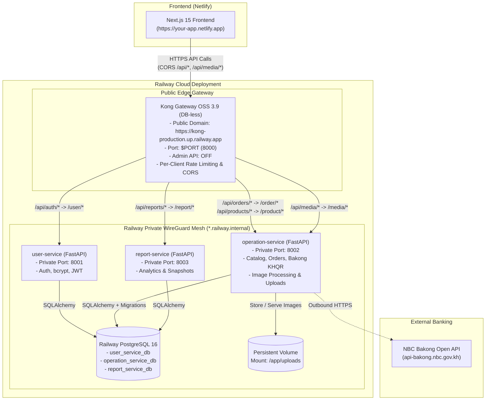

# Railway & Netlify Deployment Guide (`docs/RAILWAY_DEPLOY_GUIDE.md`)

> **Stack**: Next.js 15 Client (Deployed on Netlify), Kong Gateway OSS 3.9 (DB-less Public Ingress on Railway), 3 FastAPI Microservices (`user-service`, `operation-service`, `report-service` on Railway Private Network), PostgreSQL 16 (Railway Database Plugin), and NBC Bakong KHQR (`bakong-khqr==0.6.5`).  
> **Repository Model**:
> - Backend Monorepo (`cafe-shop-backend.git`): holds `user_service`, `operation_service`, `report_service`, `infra/railway/kong`, database migrations, and scripts.
> - Frontend Repository (`cafe-shop-frontend.git`): holds Next.js 15 client deployed on Netlify.
> **Safety Notice**: Local Docker Compose development setup (`docker-compose.yml` and `docker-compose.local.yml`) remains 100% intact and functional.  
> Every recommendation below is marked **[MUST]**, **[SHOULD]**, or **[NICE-TO-HAVE]**.

---

## 1. Architecture Overview

### Single Public Ingress via Kong API Gateway

In this deployment topology:
1. **Next.js Frontend on Netlify**:
   The frontend is hosted on Netlify (`https://<your-app>.netlify.app`). The client browser talks directly over HTTPS to the Kong API Gateway on Railway (`NEXT_PUBLIC_API_BASE_URL=https://<your-kong-service>.up.railway.app`).
2. **Kong API Gateway as Single Public Entry Point**:
   Kong is the **only backend service with a public Railway domain**. All incoming API traffic (`/api/auth/*`, `/api/orders/*`, `/api/products/*`, `/api/media/*`, `/api/reports/*`) enters through Kong. The Admin API is completely disabled (`KONG_ADMIN_LISTEN=off`), and Kong runs in declarative DB-less mode.
3. **Private WireGuard Microservices**:
   The three FastAPI services (`user-service`, `operation-service`, `report-service`) and PostgreSQL have **no public domains** and are accessible exclusively via Railway's internal encrypted network (`*.railway.internal`).



---

## 2. Before You Start

- **[MUST] Verify No Secrets Are Committed**:
  Ensure with `git ls-files` that no `.env` or `*.pem` files are tracked:
  ```powershell
  cd D:\Study\Year-4\Final-Python\coffee_shop
  git ls-files | Select-String -Pattern '\.env$|\.pem$'

  cd ..\coffee_shop_frontend
  git ls-files | Select-String -Pattern '\.env$|\.pem$'
  ```
  *(Both commands must produce zero output).*
- **[MUST] Deploy Branch**: Use the verified branch `deploy/railway-prep` (or merge into `main`).

---

## 3. Region Warning for NBC Bakong Payments

> [!WARNING]
> **Bakong Cambodian IP Geo-Restriction**:  
> The National Bank of Cambodia (NBC) Bakong Open API production gateway (`api-bakong.nbc.gov.kh`) enforces geographic IP filtering and returns **HTTP 403 Forbidden** for incoming API calls originating from IP addresses outside Cambodia.

### Recommended Railway Region
- **Southeast Asia (Singapore)** (`asia-southeast1-eqsg3a`) — Closest region to Cambodia for minimal network latency.

### Handling 403 in `operation-service`
1. **Bakong Relay Token (`rbk...`)**: The `bakong-khqr` SDK automatically routes via `https://api.khqr.dev/v1` when an `rbk...` token is provided, bypassing geo-blocking.
2. **Outbound Cambodia Proxy**: Configure `HTTPS_PROXY` in `operation-service` pointing to a Cambodian proxy.
3. **Local Testing for Real Payments**: Test live payments using local Docker Desktop on your Cambodian network.

---

## 4. Railway Build Configuration & Root Directory Setup

### Root Cause of Previous Railway Build Failures

Railway previously reported errors such as:
```text
COPY entrypoint.sh /entrypoint.sh
"/entrypoint.sh": not found
```
And:
```text
sed: can't read /app/entrypoint.sh: No such file or directory
```

**Why This Occurred**:  
When creating a service from a monorepo in the Railway dashboard, Railway defaults the **Root Directory** to `/` (the repository root).
- If Root Directory is left as `/`, Railway executes `docker build` using the repository root as the build context.
- In the repository root, there is no top-level `entrypoint.sh` (each service has its own `entrypoint.sh` inside its own directory).
- Consequently, `COPY entrypoint.sh /entrypoint.sh` in Kong failed because `./entrypoint.sh` did not exist in the root context.
- Similarly, `COPY --chown=appuser:appgroup . /app/` in `user_service` copied the repository root into `/app/`, where `/app/entrypoint.sh` was missing, causing `sed: can't read /app/entrypoint.sh: No such file or directory`.

**The Permanent Fix**:  
Configure the **Root Directory** for every service in the Railway Dashboard settings:

| Railway Service Name | GitHub Repository | Root Directory | Dockerfile Path | Port | Exposure | Healthcheck Path | Volume Mount |
| :--- | :--- | :--- | :--- | :--- | :--- | :--- | :--- |
| **`postgres`** | N/A *(Plugin)* | N/A | N/A | `5432` | **Private** | `pg_isready` *(Built-in)* | Automated disk |
| **`user-service`** | `cafe-shop-backend` | `user_service` | `Dockerfile` | `8001` | **Private** | `/health` | None |
| **`operation-service`** | `cafe-shop-backend` | `operation_service` | `Dockerfile` | `8002` | **Private** | `/health` | `/app/uploads` |
| **`report-service`** | `cafe-shop-backend` | `report_service` | `Dockerfile` | `8003` | **Private** | `/health` | None |
| **`kong`** | `cafe-shop-backend` | `infra/railway/kong` | `Dockerfile` | `8000` | **Public** *(Generate Domain)* | `/gateway/health` | None |
| **Frontend (Netlify)** | `cafe-shop-frontend` | `/` | N/A *(Node.js)* | N/A | **Public** | `/login` | None |

---

## 5. Environment Variables per Service

> **[MUST] Secret Generation on Windows PowerShell**:  
> Generate a strong, cryptographically secure 48-byte URL-safe secret for `JWT_SECRET_KEY`:
> ```powershell
> python -c "import secrets; print(secrets.token_urlsafe(48))"
> ```
> Use Railway's **Raw Editor** in the **Variables** tab to copy-paste multi-line variable blocks quickly.

### 5.1 Shared Across Backend Services

| Variable Name | Description | Where to Set |
| :--- | :--- | :--- |
| `JWT_SECRET_KEY` | HMAC-SHA256 secret. **Must be 100% identical** across `user-service`, `operation-service`, and `report-service`. | `user-service`, `operation-service`, `report-service` |

---

### 5.2 `user-service` Variables (Railway Private)

| Variable Name | Recommended Value / Reference | Secret? |
| :--- | :--- | :--- |
| `ENVIRONMENT` | `production` | No |
| `PORT` | `8001` | No |
| `DB_HOST` | `${{Postgres.PGHOST}}` | No |
| `DB_PORT` | `${{Postgres.PGPORT}}` | No |
| `DB_NAME` | `user_service_db` | No |
| `DB_USER` | `${{Postgres.PGUSER}}` | No |
| `DB_PASSWORD` | `${{Postgres.PGPASSWORD}}` | **Yes** |
| `JWT_SECRET_KEY` | `<your-generated-48-char-secret>` | **Yes** |
| `JWT_ALGORITHM` | `HS256` | No |
| `JWT_ACCESS_TOKEN_EXPIRE_MINUTES` | `60` | No |
| `CORS_ORIGINS` | `https://<your-app>.netlify.app` | No |

---

### 5.3 `operation-service` Variables (Railway Private)

| Variable Name | Recommended Value / Reference | Secret? |
| :--- | :--- | :--- |
| `ENVIRONMENT` | `production` | No |
| `PORT` | `8002` | No |
| `DB_HOST` | `${{Postgres.PGHOST}}` | No |
| `DB_PORT` | `${{Postgres.PGPORT}}` | No |
| `DB_NAME` | `operation_service_db` | No |
| `DB_USER` | `${{Postgres.PGUSER}}` | No |
| `DB_PASSWORD` | `${{Postgres.PGPASSWORD}}` | **Yes** |
| `JWT_SECRET_KEY` | `<same-secret-as-user-service>` | **Yes** |
| `JWT_ALGORITHM` | `HS256` | No |
| `CORS_ORIGINS` | `https://<your-app>.netlify.app` | No |
| `BAKONG_ACCOUNT_ID` | `<your-merchant@bank>` | **Yes** |
| `BAKONG_TOKEN` | `<your-bakong-bearer-jwt>` | **Yes** |
| `BAKONG_MERCHANT_NAME` | `Coffee Shop` | No |
| `BAKONG_MERCHANT_CITY` | `Phnom Penh` | No |
| `BAKONG_MAX_AMOUNT_USD` | `1.00` | No |
| `UPLOAD_DIR` | `/app/uploads` | No |
| `RAILWAY_RUN_UID` | `0` *(Required for persistent volume permission fix)* | No |

---

### 5.4 `report-service` Variables (Railway Private)

| Variable Name | Recommended Value / Reference | Secret? |
| :--- | :--- | :--- |
| `ENVIRONMENT` | `production` | No |
| `PORT` | `8003` | No |
| `DB_HOST` | `${{Postgres.PGHOST}}` | No |
| `DB_PORT` | `${{Postgres.PGPORT}}` | No |
| `DB_NAME` | `report_service_db` | No |
| `DB_USER` | `${{Postgres.PGUSER}}` | No |
| `DB_PASSWORD` | `${{Postgres.PGPASSWORD}}` | **Yes** |
| `USER_SERVICE_BASE_URL` | `http://${{user-service.RAILWAY_PRIVATE_DOMAIN}}:8001` | No |
| `OPERATION_SERVICE_BASE_URL` | `http://${{operation-service.RAILWAY_PRIVATE_DOMAIN}}:8002` | No |
| `JWT_SECRET_KEY` | `<same-secret-as-user-service>` | **Yes** |
| `JWT_ALGORITHM` | `HS256` | No |
| `SERVICE_TOKEN_EXPIRE_MINUTES` | `5` | No |
| `SYNC_PAGE_SIZE` | `100` | No |
| `CORS_ORIGINS` | `https://<your-app>.netlify.app` | No |

---

### 5.5 `kong` Variables (Railway PUBLIC Ingress)

| Variable Name | Recommended Value / Reference | Secret? |
| :--- | :--- | :--- |
| `PORT` | `8000` *(or Railway default)* | No |
| `USER_SERVICE_URL` | `http://${{user-service.RAILWAY_PRIVATE_DOMAIN}}:8001` | No |
| `OPERATION_SERVICE_URL` | `http://${{operation-service.RAILWAY_PRIVATE_DOMAIN}}:8002` | No |
| `REPORT_SERVICE_URL` | `http://${{report-service.RAILWAY_PRIVATE_DOMAIN}}:8003` | No |
| `CORS_ORIGIN` | `https://<your-app>.netlify.app` | No |
| `KONG_TRUSTED_IPS` | `0.0.0.0/0,::/0` | No |
| `KONG_REAL_IP_HEADER` | `X-Forwarded-For` | No |
| `KONG_REAL_IP_RECURSIVE` | `on` | No |

---

### 5.6 Netlify Frontend Variables (`cafe-shop-frontend`)

Set these environment variables in your **Netlify Site Configuration** -> **Environment variables**:

| Variable Name | Recommended Value | Secret? | Description |
| :--- | :--- | :--- | :--- |
| `NEXT_PUBLIC_API_BASE_URL` | `https://${{kong.RAILWAY_PUBLIC_DOMAIN}}` *(e.g. `https://kong-production.up.railway.app`)* | No | Directs all frontend browser API and media requests to Kong's public gateway |
| `INTERNAL_API_BASE_URL` | `https://${{kong.RAILWAY_PUBLIC_DOMAIN}}` *(e.g. `https://kong-production.up.railway.app`)* | No | Used for Netlify SSR and Open Graph generation |
| `NEXT_PUBLIC_BASE_URL` | `https://<your-app>.netlify.app` | No | Canonical frontend URL for social media share previews |
| `NODE_ENV` | `production` | No | Production mode |

---

## 6. Step-by-Step Deployment Walkthrough

### Step 6.1: Initialize Databases with One-Time Script

1. In Railway, add the **PostgreSQL** plugin.
2. In PostgreSQL service -> **Settings** -> **Networking** -> click **Add TCP Proxy**.
3. Under **Connect** tab -> **Public Network**, copy the **Database URL** (`postgresql://postgres:<password>@...`).
4. On your local Windows machine, run:
   ```powershell
   $env:RAILWAY_PG_PUBLIC_URL = "postgresql://postgres:<password>@<host>:<port>/railway"
   powershell -ExecutionPolicy Bypass -File .\coffee_shop\scripts\railway\create-databases.ps1
   ```
5. Confirm output displays `[SUCCESS] All 3 application databases are ready in Railway PostgreSQL!`.
6. Return to Railway Postgres service -> **Settings** -> **Networking** -> remove the public TCP Proxy to prevent network egress charges.

---

### Step 6.2: Deploy Backend Services & Add Volume

1. **`user-service`**:
   - Go to service **Settings** -> set **Root Directory** to `user_service`.
   - Go to **Variables** tab -> paste the variables from Section 5.2.
   - Set **Healthcheck Path** to `/health`.
2. **`operation-service`**:
   - Go to service **Settings** -> set **Root Directory** to `operation_service`.
   - Go to **Variables** tab -> paste the variables from Section 5.3 (ensure `RAILWAY_RUN_UID=0` is included).
   - Go to **Volumes** tab -> click **Add Volume** -> set **Mount Path** to `/app/uploads`.
   - Set **Healthcheck Path** to `/health`.
3. **`report-service`**:
   - Go to service **Settings** -> set **Root Directory** to `report_service`.
   - Go to **Variables** tab -> paste the variables from Section 5.4.
   - Set **Healthcheck Path** to `/health`.
4. Deploy the three services and verify in their deployment logs that each reports:
   `Prestart finished.` and `Uvicorn running on http://0.0.0.0:<port>`.

---

### Step 6.3: Deploy Kong Gateway (Public Ingress)

1. In Railway, select your `kong` service (connected to `cafe-shop-backend.git`).
2. Go to **Settings** -> set **Root Directory** to `infra/railway/kong`.
3. Under **Networking**, click **Generate Domain** (e.g. `kong-production.up.railway.app`).
4. Go to **Variables** tab -> paste the variables from Section 5.5.
   *(Set `CORS_ORIGIN` to your Netlify site URL, e.g. `https://<your-app>.netlify.app`).*
5. Set **Healthcheck Path** to `/gateway/health`.
6. Deploy Kong and verify the deployment log shows:
   `[KONG ENTRYPOINT] Configuration valid. Starting Kong Gateway in DB-less mode on port ...`

---

### Step 6.4: Deploy Frontend to Netlify

1. In Netlify, click **Add new site** -> **Import an existing project** -> select GitHub -> select `cafe-shop-frontend`.
2. Configure build settings:
   - **Build command**: `npm run build`
   - **Publish directory**: `.next`
3. Add the Environment Variables from Section 5.6:
   - `NEXT_PUBLIC_API_BASE_URL`: `https://<kong-domain>.up.railway.app`
   - `INTERNAL_API_BASE_URL`: `https://<kong-domain>.up.railway.app`
   - `NEXT_PUBLIC_BASE_URL`: `https://<your-app>.netlify.app`
4. Click **Deploy Site**.
5. Once deployed, note your Netlify domain (`https://<your-app>.netlify.app`).
6. If needed, update `CORS_ORIGIN` in Kong and `CORS_ORIGINS` in `user-service`, `operation-service`, and `report-service` to match your exact Netlify domain.

---

## 7. Verification Checklist

- [ ] **1. Netlify Frontend Loads**: Open `https://<your-app>.netlify.app` in your browser. Verify the home page and `/login` load with HTTP 200.
- [ ] **2. Guest Catalog & Browsing**: Open `/products` without logging in. Products and categories render through Kong (`/api/products`).
- [ ] **3. Perimeter 401 Check**: Open `https://<kong-domain>.up.railway.app/api/auth/me` directly in your browser. Confirm it returns `HTTP 401 Unauthorized` with JSON error payload.
- [ ] **4. User Registration & Login**: Register a test account and log in. Verify JWT session is established.
- [ ] **5. Product Image Upload & Volume Check**:
  - Log in as staff/admin and upload a product photo.
  - Verify the photo loads on `/products/[id]` via `https://<kong-domain>.up.railway.app/api/media/<key>`.
  - Trigger a redeploy of `operation-service` in Railway.
  - Refresh `/products/[id]` and verify the image still loads (confirms persistent volume persistence).
- [ ] **6. Telegram / Chat Share Link Preview**:
  - Open `/products/1` and click **Share**.
  - Paste the link (`https://<your-app>.netlify.app/products/1`) into Telegram.
  - Confirm the rich preview card displays with product photo, name, and formatted price.
- [ ] **7. Controlled Bakong Payment Verification ($0.01 USD)**:
  - Create a test order for `$0.01` USD.
  - Click **Pay with Bakong KHQR** and verify dynamic SVG QR renders.
  - If `operation-service` is hosted outside Cambodia, check deployment logs for HTTP 403 geo-restriction warnings (see Section 3).

---

## 8. Updating the Application

- **Automatic Deployments**: Any push to your deployed branch triggers an automated build on Railway and Netlify.
- **Rollbacks**: If a deployment fails:
  1. Go to the service dashboard in Railway (or Netlify).
  2. Click the **Deployments** tab.
  3. Locate the last healthy deployment -> click `...` -> select **Rollback**.

---

## 9. Costs & Cleanup

- **Turn Off Public Postgres TCP Proxy**: Once initial database provisioning (`create-databases.ps1`) is complete, remove the public TCP proxy on Postgres to avoid public network egress fees.
- **Usage-Based Billing**: Railway meters CPU, RAM, and persistent volume storage. To pause billing when not working on the study project, select your project -> click **Settings** -> **Delete Project** or stop individual services.

---

## 10. Troubleshooting Table

| Problem / Symptom | Root Cause | Verified Resolution |
| :--- | :--- | :--- |
| **`COPY entrypoint.sh /entrypoint.sh: not found`** | Root Directory was left as `/` instead of `/infra/railway/kong`. | In Railway service Settings, set **Root Directory** to `infra/railway/kong`. |
| **`sed: can't read /app/entrypoint.sh: No such file or directory`** | Root Directory was left as `/` instead of `/user_service` (or `/operation_service`, `/report_service`). | In Railway service Settings, set **Root Directory** to `user_service`, `operation_service`, or `report_service`. |
| **CORS errors in browser on Netlify** | Kong's `CORS_ORIGIN` or backend's `CORS_ORIGINS` does not match the Netlify domain. | Set `CORS_ORIGIN=https://<your-app>.netlify.app` in Kong and `CORS_ORIGINS=https://<your-app>.netlify.app` in backend services. |
| **Service not reachable on private network** | Mismatched service name in `.railway.internal` reference or wrong port. | Use Railway reference variable syntax: `http://${{<service-name>.RAILWAY_PRIVATE_DOMAIN}}:<port>`. |
| **`PermissionError: [Errno 13] Permission denied: '/app/uploads/...'`** | Railway mounts volumes as `root:root`, while the container runs as unprivileged user `appuser` (`UID 1001`). | Set `RAILWAY_RUN_UID=0` in `operation-service` variables. The container will run with root filesystem permissions for volume access. |
| **Database connection refused on startup** | PostgreSQL container took longer to start than the microservice. | Covered automatically: `entrypoint.sh` executes `app.prestart` which retries database connection up to 30 times with exponential backoff. |
| **Bakong returns `403 Forbidden`** | Production Bakong API rejects requests from outside Cambodia. | Check `operation-service` logs. Use a Bakong Relay token (`rbk...`), an outbound Cambodia proxy, or test payments locally via Docker Desktop. |

---

## 11. Local Docker Setup Remains Unchanged

The local Docker Compose configuration remains completely functional:
```powershell
# Local development workflow:
cd D:\Study\Year-4\Final-Python\coffee_shop
docker compose up -d --build
powershell -ExecutionPolicy Bypass -File .\scripts\smoke.ps1
```
All local ports, volumes, and healthcheck configurations remain 100% operational.
