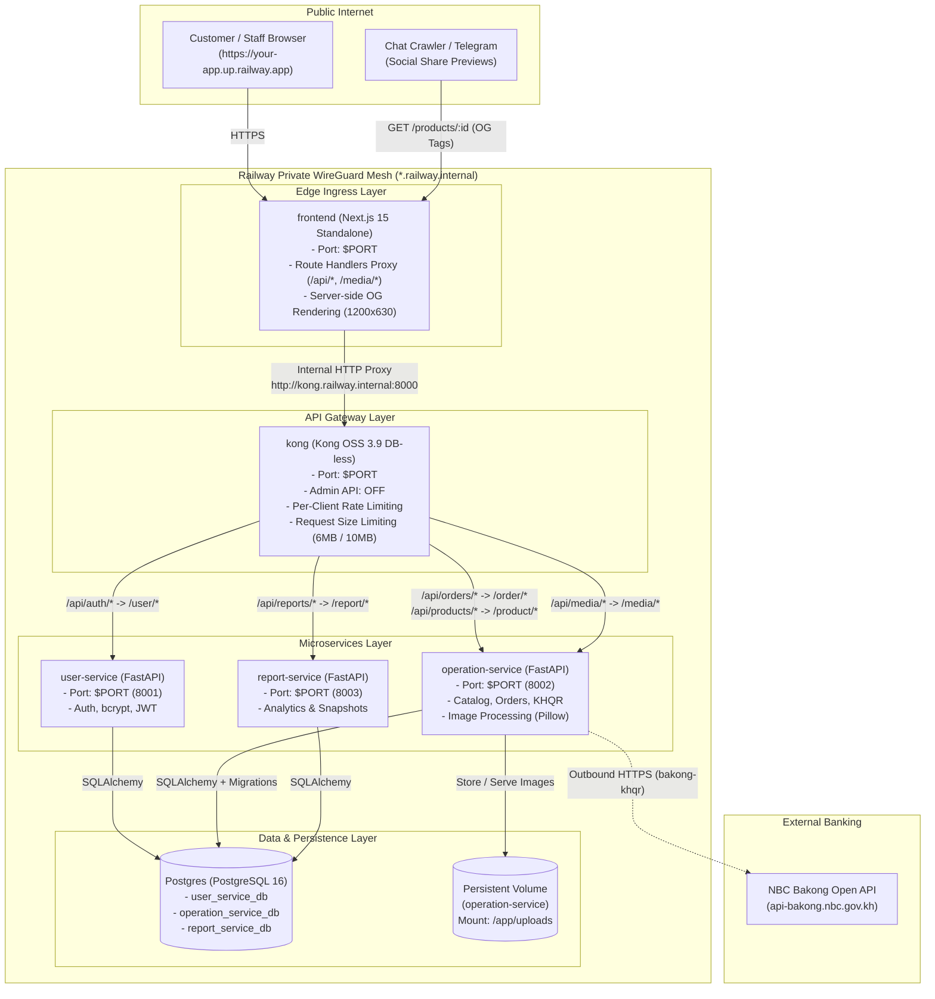

# Railway Monorepo Deployment Guide (`docs/RAILWAY_DEPLOY_GUIDE.md`)

> **Stack**: Next.js 15 Standalone (Public Edge), Kong Gateway OSS 3.9 (DB-less Private Gateway), 3 FastAPI Microservices (`user-service`, `operation-service`, `report-service`), PostgreSQL 16 (Private Network), and NBC Bakong KHQR (`bakong-khqr==0.6.5`).  
> **Repository Model**: One GitHub monorepo hosting backend microservices, Kong configuration, database migrations, and the frontend.  
> **Safety Notice**: Local Docker Compose development setup (`docker-compose.yml` and `docker-compose.local.yml`) remains 100% intact and functional.  
> Every recommendation below is marked **[MUST]**, **[SHOULD]**, or **[NICE-TO-HAVE]**.

---

## 1. Architecture Overview

### Why This Architecture Is Used

1. **Perimeter Security & Single Public Ingress**:
   Only the **frontend** service has a public Railway domain (`https://<your-app>.up.railway.app`). The API Gateway (Kong), all three FastAPI microservices, and PostgreSQL have **no public domains** and are accessible strictly through Railway's private encrypted WireGuard mesh network (`*.railway.internal`).
2. **Same-Origin Browser Requests (No CORS Issues)**:
   The client browser talks to a single domain (the frontend). Browser API calls use relative paths (`/api/...`) and media paths (`/media/...`). The Next.js server runtime proxies these requests directly to Kong over the private network. Because browser requests are same-origin:
   - Browser cross-origin preflight checks (CORS) are completely bypassed.
   - Authentication headers and cookies are never blocked by third-party cookie restrictions.
   - Social media crawlers (Telegram, Facebook, WhatsApp) fetch canonical Open Graph preview images through the same public domain without needing direct access to backend containers.
3. **Declarative DB-less Gateway**:
   Kong runs in **DB-less mode** (`KONG_DATABASE=off`), parsing a declarative configuration template rendered dynamically at container start. The Admin API and Kong Manager are disabled (`KONG_ADMIN_LISTEN=off`), preventing any unauthorized external or internal mutations.



---

## 2. Before You Start

- **[MUST] Push the Prepared Branch to GitHub**:
  Push the `deploy/railway-prep` branch to your GitHub repository:
  ```powershell
  # Push the prepared deployment branches to your GitHub remotes:
  cd D:\Study\Year-4\Python\coffee_shop
  git push -u origin deploy/railway-prep

  cd ..\coffee_shop_frontend
  git push -u origin deploy/railway-prep
  ```
- **[MUST] Verify No Secrets Are Committed**:
  Verify with `git ls-files` that no `.env` or `*.pem` files are tracked in Git:
  ```powershell
  cd D:\Study\Year-4\Python\coffee_shop
  git ls-files | Select-String -Pattern '\.env$|\.pem$'

  cd ..\coffee_shop_frontend
  git ls-files | Select-String -Pattern '\.env$|\.pem$'
  ```
  *(Both commands must produce zero output).*
- **[MUST] Deploy Branch**: Set your Railway services to deploy from branch `deploy/railway-prep` (or merge into `main` after verification).

---

## 3. Region Warning for NBC Bakong Payments

> [!WARNING]
> **Bakong Cambodian IP Geo-Restriction**:  
> The National Bank of Cambodia (NBC) Bakong Open API production gateway (`api-bakong.nbc.gov.kh`) enforces geographic IP filtering and returns **HTTP 403 Forbidden** for incoming API calls originating from IP addresses outside Cambodia.

### Railway Regions Availability

Railway provides server clusters in the following global regions:
- **Southeast Asia (Singapore)** (`asia-southeast1-eqsg3a`) — **[RECOMMENDED] Closest region to Cambodia for low latency.**
- **US West** (`us-west2`)
- **US East** (`us-east4-eqdc4a`)
- **Europe West** (`europe-west4-drams3a`)

Railway **does not** currently have a physical data center inside Cambodia.

### How to Detect a 403 in `operation-service` Logs

When `operation-service` attempts to check payments or request deeplinks, look for this pattern in the service deployment logs:
```text
httpx.HTTPStatusError: Server error '403 Forbidden' for url 'https://api-bakong.nbc.gov.kh/v1/check_transaction_by_md5'
```

### Options to Handle Bakong Geo-Restriction

1. **Bakong Relay Token (`rbk...`)**: If you possess an `rbk...` relay token from NBC Bakong, the `bakong-khqr==0.6.5` SDK automatically routes requests via `https://api.khqr.dev/v1`, which handles regional routing without geo-blocking.
2. **Cambodia Proxy / VPN Tunnel**: Route outbound `operation-service` HTTPS traffic through an HTTP/HTTPS forward proxy hosted in Cambodia via the `HTTPS_PROXY` environment variable.
3. **Local Testing for Real Payments**: Test live payment QR scanning on your Windows host via Docker Desktop (which uses your local Cambodian ISP public IP) while keeping cloud deployments for staging and demonstration.

---

## 4. Service Configuration Table

Create the following 6 services inside your Railway project (using the GitHub repo connection):

| Service Name in Railway | Root Directory | Dockerfile Path | Port | Exposure | Healthcheck Path | Volume Mount | Start / Pre-deploy Command |
| :--- | :--- | :--- | :--- | :--- | :--- | :--- | :--- |
| **`postgres`** | N/A *(Railway Database Plugin)* | N/A | `5432` | **Private** | `pg_isready` *(Built-in)* | Persistent disk *(Automated)* | None |
| **`user-service`** | `user_service` | `Dockerfile` | `8001` | **Private** | `/health` | None | `sh /app/entrypoint.sh` *(Default in Dockerfile)* |
| **`operation-service`** | `operation_service` | `Dockerfile` | `8002` | **Private** | `/health` | `/app/uploads` *(Volume)* | `sh /app/entrypoint.sh` *(Default in Dockerfile)* |
| **`report-service`** | `report_service` | `Dockerfile` | `8003` | **Private** | `/health` | None | `sh /app/entrypoint.sh` *(Default in Dockerfile)* |
| **`kong`** | `infra/railway/kong` | `Dockerfile` | `8000` | **Private** | `/gateway/health` | None | `/entrypoint.sh kong docker-start` *(Default in Dockerfile)* |
| **`frontend`** | `.` *(in frontend repo)* | `Dockerfile` | `3000` | **Public** *(Generate Domain)* | `/login` | None | `node server.js` *(Default in Dockerfile)* |

> [!NOTE]
> If you deploy both backend and frontend from a single merged monorepo, set `frontend`'s Root Directory to `coffee_shop_frontend`. If you deploy from the separate frontend repo `cafe-shop-frontend.git`, leave the frontend Root Directory as `/`.

---

## 5. Environment Variables per Service

> **[MUST] Secret Generation on Windows PowerShell**:  
> Generate a strong, cryptographically secure 48-byte URL-safe secret for `JWT_SECRET_KEY`:
> ```powershell
> python -c "import secrets; print(secrets.token_urlsafe(48))"
> ```
> Use Railway's **Raw Editor** in the **Variables** tab to copy-paste multi-line variable blocks quickly.

### 5.1 Shared Across Services

| Variable Name | Description | Where to Set |
| :--- | :--- | :--- |
| `JWT_SECRET_KEY` | HMAC-SHA256 secret. **Must be 100% identical** across `user-service`, `operation-service`, and `report-service`. | `user-service`, `operation-service`, `report-service` |

---

### 5.2 `user-service` Variables

| Variable Name | Recommended Value / Reference | Secret? |
| :--- | :--- | :--- |
| `ENVIRONMENT` | `production` | No |
| `PORT` | `8001` | No |
| `DB_HOST` | `${{Postgres.PGHOST}}` | No |
| `DB_PORT` | `${{Postgres.PGPORT}}` | No |
| `DB_NAME` | `user_service_db` | No |
| `DB_USER` | `${{Postgres.PGUSER}}` | No |
| `DB_PASSWORD` | `${{Postgres.PGPASSWORD}}` | **Yes** |
| `JWT_SECRET_KEY` | `<your-generated-48-char-secret>` | **Yes** |
| `JWT_ALGORITHM` | `HS256` | No |
| `JWT_ACCESS_TOKEN_EXPIRE_MINUTES` | `60` | No |
| `CORS_ORIGINS` | `${{frontend.RAILWAY_PUBLIC_DOMAIN}}` *(or `https://<your-frontend>.up.railway.app`)* | No |

---

### 5.3 `operation-service` Variables

| Variable Name | Recommended Value / Reference | Secret? |
| :--- | :--- | :--- |
| `ENVIRONMENT` | `production` | No |
| `PORT` | `8002` | No |
| `DB_HOST` | `${{Postgres.PGHOST}}` | No |
| `DB_PORT` | `${{Postgres.PGPORT}}` | No |
| `DB_NAME` | `operation_service_db` | No |
| `DB_USER` | `${{Postgres.PGUSER}}` | No |
| `DB_PASSWORD` | `${{Postgres.PGPASSWORD}}` | **Yes** |
| `JWT_SECRET_KEY` | `<same-secret-as-user-service>` | **Yes** |
| `JWT_ALGORITHM` | `HS256` | No |
| `CORS_ORIGINS` | `${{frontend.RAILWAY_PUBLIC_DOMAIN}}` | No |
| `BAKONG_ACCOUNT_ID` | `<your-merchant@bank>` | **Yes** |
| `BAKONG_TOKEN` | `<your-bakong-bearer-jwt>` | **Yes** |
| `BAKONG_MERCHANT_NAME` | `Coffee Shop` | No |
| `BAKONG_MERCHANT_CITY` | `Phnom Penh` | No |
| `BAKONG_MAX_AMOUNT_USD` | `1.00` | No |
| `UPLOAD_DIR` | `/app/uploads` | No |
| `RAILWAY_RUN_UID` | `0` *(Required for persistent volume permission fix)* | No |

---

### 5.4 `report-service` Variables

| Variable Name | Recommended Value / Reference | Secret? |
| :--- | :--- | :--- |
| `ENVIRONMENT` | `production` | No |
| `PORT` | `8003` | No |
| `DB_HOST` | `${{Postgres.PGHOST}}` | No |
| `DB_PORT` | `${{Postgres.PGPORT}}` | No |
| `DB_NAME` | `report_service_db` | No |
| `DB_USER` | `${{Postgres.PGUSER}}` | No |
| `DB_PASSWORD` | `${{Postgres.PGPASSWORD}}` | **Yes** |
| `USER_SERVICE_BASE_URL` | `http://${{user-service.RAILWAY_PRIVATE_DOMAIN}}:8001` | No |
| `OPERATION_SERVICE_BASE_URL` | `http://${{operation-service.RAILWAY_PRIVATE_DOMAIN}}:8002` | No |
| `JWT_SECRET_KEY` | `<same-secret-as-user-service>` | **Yes** |
| `JWT_ALGORITHM` | `HS256` | No |
| `SERVICE_TOKEN_EXPIRE_MINUTES` | `5` | No |
| `SYNC_PAGE_SIZE` | `100` | No |
| `CORS_ORIGINS` | `${{frontend.RAILWAY_PUBLIC_DOMAIN}}` | No |

---

### 5.5 `kong` Variables

| Variable Name | Recommended Value / Reference | Secret? |
| :--- | :--- | :--- |
| `PORT` | `8000` | No |
| `USER_SERVICE_URL` | `http://${{user-service.RAILWAY_PRIVATE_DOMAIN}}:8001` | No |
| `OPERATION_SERVICE_URL` | `http://${{operation-service.RAILWAY_PRIVATE_DOMAIN}}:8002` | No |
| `REPORT_SERVICE_URL` | `http://${{report-service.RAILWAY_PRIVATE_DOMAIN}}:8003` | No |
| `CORS_ORIGIN` | `https://${{frontend.RAILWAY_PUBLIC_DOMAIN}}` | No |
| `KONG_TRUSTED_IPS` | `0.0.0.0/0,::/0` | No |
| `KONG_REAL_IP_HEADER` | `X-Forwarded-For` | No |
| `KONG_REAL_IP_RECURSIVE` | `on` | No |

---

### 5.6 `frontend` Variables

| Variable Name | Recommended Value / Reference | Secret? | Build Time (`ARG`)? |
| :--- | :--- | :--- | :--- |
| `NODE_ENV` | `production` | No | No |
| `PORT` | `3000` | No | No |
| `HOSTNAME` | `0.0.0.0` | No | No |
| `KONG_INTERNAL_URL` | `http://${{kong.RAILWAY_PRIVATE_DOMAIN}}:8000` | No | No *(Runtime dynamic)* |
| `INTERNAL_API_BASE_URL` | `http://${{kong.RAILWAY_PRIVATE_DOMAIN}}:8000` | No | No *(Runtime dynamic)* |
| `PUBLIC_BASE_URL` | `https://${{RAILWAY_PUBLIC_DOMAIN}}` | No | **Yes** (`ARG PUBLIC_BASE_URL`) |
| `NEXT_PUBLIC_BASE_URL` | `https://${{RAILWAY_PUBLIC_DOMAIN}}` | No | **Yes** (`ARG NEXT_PUBLIC_BASE_URL`) |
| `NEXT_PUBLIC_API_BASE_URL` | *(Leave empty for same-origin proxy)* | No | **Yes** (`ARG NEXT_PUBLIC_API_BASE_URL`) |

---

## 6. Order of Steps (Exact Dashboard Walkthrough)

### Step 6.1: Initialize Databases with One-Time Script

1. In Railway, open your **Postgres** service.
2. Go to **Settings** -> **Networking** -> click **Add TCP Proxy**.
3. Go to the **Connect** tab -> under **Public Network**, copy the **Database URL** (`postgresql://postgres:<password>@...`).
4. On your local Windows machine, run:
   ```powershell
   $env:RAILWAY_PG_PUBLIC_URL = "postgresql://postgres:<password>@<host>:<port>/railway"
   powershell -ExecutionPolicy Bypass -File .\coffee_shop\scripts\railway\create-databases.ps1
   ```
5. Confirm output displays `[SUCCESS] All 3 application databases are ready in Railway PostgreSQL!`.
6. Return to Railway Postgres service -> **Settings** -> **Networking** -> remove the public TCP Proxy to prevent egress fees.

---

### Step 6.2: Deploy Backend Services & Add Volume

1. **`user-service`**:
   - Go to service **Settings** -> set **Root Directory** to `user_service`.
   - Go to **Variables** tab -> paste the variables from Section 5.2.
   - Set **Healthcheck Path** to `/health`.
2. **`operation-service`**:
   - Go to service **Settings** -> set **Root Directory** to `operation_service`.
   - Go to **Variables** tab -> paste the variables from Section 5.3 (including `RAILWAY_RUN_UID=0`).
   - Go to **Volumes** tab -> click **Add Volume** -> set **Mount Path** to `/app/uploads`.
   - Set **Healthcheck Path** to `/health`.
3. **`report-service`**:
   - Go to service **Settings** -> set **Root Directory** to `report_service`.
   - Go to **Variables** tab -> paste the variables from Section 5.4.
   - Set **Healthcheck Path** to `/health`.
4. Deploy the three services and verify in their deployment logs that each service reports `Prestart finished.` and `Uvicorn running on http://0.0.0.0:<port>`.

---

### Step 6.3: Deploy Kong Gateway (Private)

1. In Railway, select your `kong` service.
2. Go to **Settings** -> set **Root Directory** to `infra/railway/kong`.
3. Go to **Variables** tab -> paste the variables from Section 5.5.
4. Set **Healthcheck Path** to `/gateway/health`.
5. Ensure **Networking** has **no public domain**.
6. Trigger deployment and check logs to confirm:
   `[KONG ENTRYPOINT] Configuration valid. Starting Kong Gateway in DB-less mode on port 8000...`

---

### Step 6.4: Configure & Deploy Frontend

1. Select your `frontend` service.
2. Go to **Settings** -> set Root Directory (e.g. `coffee_shop_frontend` or `/`).
3. Under **Networking**, click **Generate Domain** (e.g. `your-app.up.railway.app`).
4. Go to **Variables** tab -> paste variables from Section 5.6.
   Ensure `PUBLIC_BASE_URL` is set to `https://<your-generated-domain>`.
5. Set **Healthcheck Path** to `/login`.
6. Click **Redeploy** so Next.js embeds the public domain into the Open Graph tags at build time.

---

### Step 6.5: Set CORS Origin on Kong and Backends

1. Update `CORS_ORIGIN` in `kong` to `https://<your-generated-domain>`.
2. Update `CORS_ORIGINS` in `user-service`, `operation-service`, and `report-service` to `https://<your-generated-domain>`.

---

## 7. Verification Checklist

- [ ] **1. Frontend Loads**: Open `https://<your-domain>.up.railway.app` in your browser. Verify the home page and `/login` load with HTTP 200.
- [ ] **2. Guest Catalog & Browsing**: Open `/products` without logging in. Products and categories render through the frontend proxy (`/api/products`).
- [ ] **3. Perimeter 401 Check**: Open `https://<your-domain>.up.railway.app/api/auth/me` directly in your browser. Confirm it returns `HTTP 401 Unauthorized` with JSON error payload.
- [ ] **4. User Registration & Login**: Register a test account and log in. Verify JWT session is established and cart is preserved.
- [ ] **5. Product Image Upload & Volume Check**:
  - Log in as staff/admin and upload a product photo.
  - Verify the photo appears on `/products/[id]` via `/api/media/<key>`.
  - Trigger a redeploy of `operation-service` in Railway.
  - Refresh `/products/[id]` and verify the image still loads (confirms persistent volume persistence).
- [ ] **6. Telegram / Chat Share Link Preview**:
  - Open `/products/1` and click **Share**.
  - Paste the canonical link (`https://<your-domain>.up.railway.app/products/1`) into Telegram.
  - If Telegram previously cached the URL, message `@WebpageBot` on Telegram with `/link https://<your-domain>.up.railway.app/products/1` to force a cache refresh.
  - Confirm the rich preview card displays with product photo, name, and formatted price.
- [ ] **7. Controlled Bakong Payment Verification ($0.01 USD)**:
  - Create a test order for `$0.01` USD.
  - Click **Pay with Bakong KHQR** and verify dynamic SVG QR renders.
  - If `operation-service` is hosted outside Cambodia, check deployment logs for HTTP 403 geo-restriction warnings (see Section 3).

---

## 8. Updating the Application

- **Automatic Deployments**: Any push to your deployed branch triggers an automated Railway build and zero-downtime rolling deployment.
- **Rollbacks**: If a deployment fails or introduces regressions:
  1. Go to the service dashboard in Railway.
  2. Click the **Deployments** tab.
  3. Locate the last healthy deployment -> click the `...` menu -> select **Rollback**.
- **Reading Live Logs**: Click any service -> select **View Logs** (or use the filter for `[prestart]` or `uvicorn`).

---

## 9. Costs & Cleanup

- **Turn Off Public Postgres TCP Proxy**: Once initial database provisioning (`create-databases.ps1`) is complete, remove the public TCP proxy on Postgres to avoid public network egress fees.
- **Usage-Based Billing**: Railway meters CPU, RAM, and persistent volume storage. To pause billing when not working on the study project, select your project -> click **Settings** -> **Delete Project** or stop individual services.

---

## 10. Troubleshooting Table

| Problem / Symptom | Root Cause | Verified Resolution |
| :--- | :--- | :--- |
| **Build fails with "file not found" or `COPY` failed** | Dockerfile attempted to copy files from outside the service's Root Directory. | Ensure Root Directory is set correctly and the service Dockerfile copies only from its own folder (as implemented in Step 1). |
| **502 Bad Gateway from public domain** | Next.js server is not binding to `0.0.0.0` or listening on Railway's assigned `PORT`. | Ensure `HOSTNAME=0.0.0.0` and `PORT` are set in the service variables or Dockerfile. |
| **Service not reachable on private network** | Mismatched service name in `.railway.internal` reference or wrong port. | Use Railway reference variable syntax: `http://${{<service-name>.RAILWAY_PRIVATE_DOMAIN}}:<port>`. |
| **`PermissionError: [Errno 13] Permission denied: '/app/uploads/...'`** | Railway mounts volumes as `root:root`, while the container runs as unprivileged user `appuser` (`UID 1001`). | Set `RAILWAY_RUN_UID=0` in `operation-service` variables. The container will run with root filesystem permissions for volume access. |
| **Database connection refused on startup** | PostgreSQL container took longer to start than the microservice. | Covered automatically: `entrypoint.sh` executes `app.prestart` which retries database connection up to 30 times with exponential backoff. |
| **Open Graph image missing or relative in chat preview** | `PUBLIC_BASE_URL` was not set at build time for the Next.js standalone build. | Set `PUBLIC_BASE_URL=https://<your-domain>.up.railway.app` and redeploy the frontend so `NEXT_PUBLIC_*` values are baked into the bundle. |
| **Kong returns `404 Not Found`** | Request path does not match any route in `kong.template.yml`. | Verify route path in `scripts/check-kong-routes.ps1` to ensure local and Railway gateway configs match. |
| **Rate limit hits all users (`429 Too Many Requests`)** | Kong is seeing the frontend container's internal IP for all proxied requests instead of client IP. | Configure `KONG_TRUSTED_IPS=0.0.0.0/0,::/0` and `KONG_REAL_IP_HEADER=X-Forwarded-For` in `kong` variables. |
| **Bakong returns `403 Forbidden`** | Production Bakong API rejects requests from outside Cambodia. | Check `operation-service` logs. Use a Bakong Relay token (`rbk...`), an outbound Cambodia proxy, or test payments locally via Docker Desktop. |

---

## 11. Local Docker Setup Remains Unchanged

The local Docker Compose configuration remains completely functional:
```powershell
# Local development workflow:
cd D:\Study\Year-4\Python\coffee_shop
docker compose up -d --build
powershell -ExecutionPolicy Bypass -File .\scripts\smoke.ps1
```
All local ports, volumes, and healthcheck configurations remain 100% operational.
